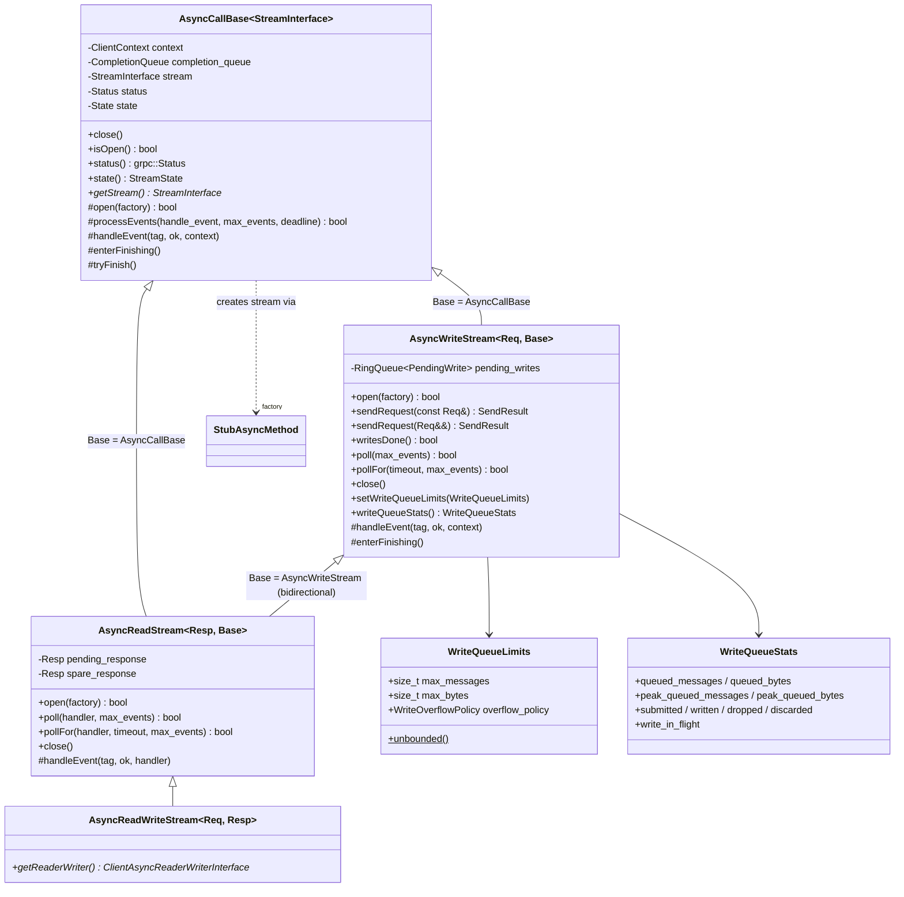
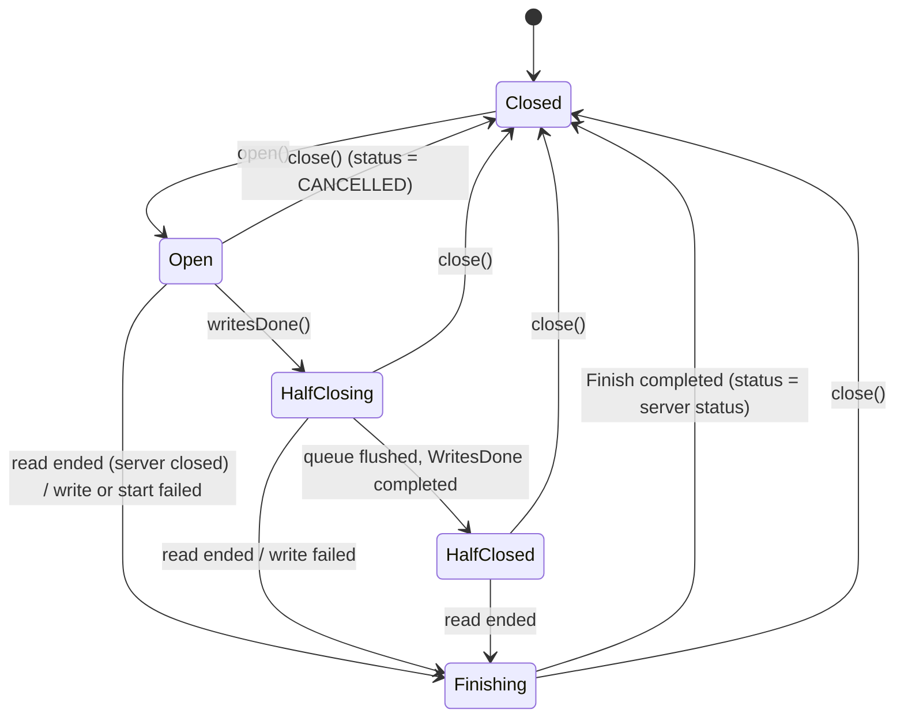
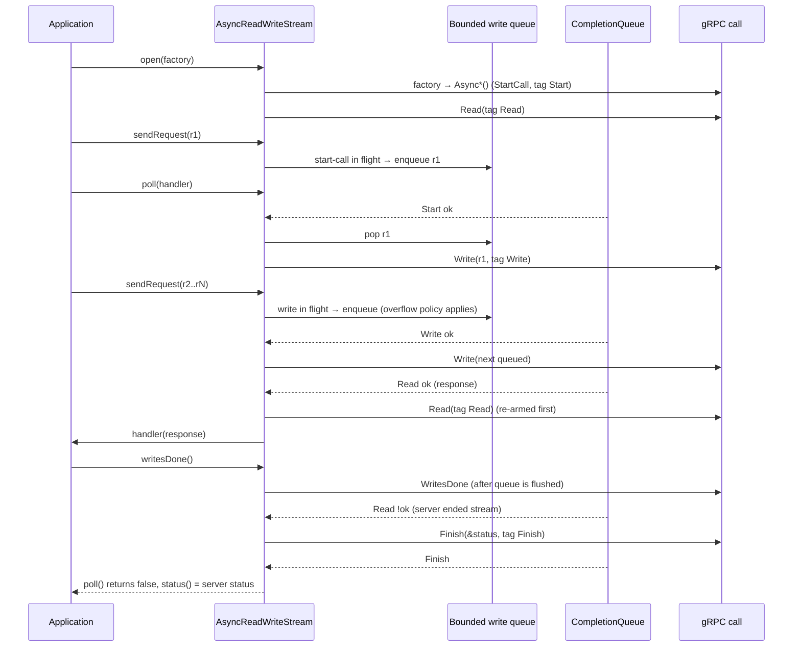

# GRPC Async Stream

A header-only C++20 utility that wraps the gRPC asynchronous client streams — **bidirectional**
(`grpc::ClientAsyncReaderWriterInterface`), **client-streaming** (`grpc::ClientAsyncWriterInterface`) and
**server-streaming** (`grpc::ClientAsyncReaderInterface`) — behind a small, single-threaded, poll-driven API.
It owns the completion queue, operation tags, write serialization, half-close and `Finish`; application
code only says *how to open the call* and *what to do with each response*. Requests produced faster than
they can be sent go into a **bounded write queue** with a configurable overflow policy, so memory stays
bounded under any load.

```cpp
#include <grpc_async_stream/AsyncReadWriteStream.h>

grpc_async_stream::AsyncReadWriteStream<ChatRequest, ChatResponse> stream;

stream.open([&](grpc::ClientContext* ctx, grpc::CompletionQueue* cq, void* tag) {
    ctx->AddMetadata("authorization", token);
    return stub->AsyncOpenChatStream(ctx, cq, tag);
});

stream.sendRequest(request); // never blocks

while (stream.poll([&](ChatResponse&& response) { // never blocks
    handle(std::move(response));
}))
{
    doOtherWork();
}
if (!stream.status().ok()) {
    /* inspect error */
}
```

`AsyncWriteStream` (many requests, one response) and `AsyncReadStream` (one request, many responses)
offer one side each:

```cpp
#include <grpc_async_stream/AsyncWriteStream.h>

UploadSummary summary; // receives the response; must outlive the call
grpc_async_stream::AsyncWriteStream<UploadChunk> upload;

upload.open([&](grpc::ClientContext* ctx, grpc::CompletionQueue* cq, void* tag) {
    return stub->AsyncUpload(ctx, &summary, cq, tag);
});
upload.sendRequest(chunk); // never blocks
upload.writesDone();       // flushes the queue, then half-closes
while (upload.poll()) {    // never blocks
    doOtherWork();
}
if (upload.status().ok()) {
    use(summary);
}
```

```cpp
#include <grpc_async_stream/AsyncReadStream.h>

grpc_async_stream::AsyncReadStream<PriceUpdate> prices;

prices.open([&](grpc::ClientContext* ctx, grpc::CompletionQueue* cq, void* tag) {
    return stub->AsyncSubscribe(ctx, subscription, cq, tag); // the request is serialized right away
});
while (prices.poll([&](PriceUpdate&& update) { apply(update); })) { // never blocks
    doOtherWork();
}
```

---

## Contents

- [Features](#features)
- [Architecture](#architecture)
- [Data flow](#data-flow)
- [Bounded write queue](#bounded-write-queue)
- [API reference](#api-reference)
- [Building](#building)
- [Platform support and memory checks](#platform-support-and-memory-checks)
- [Tests](#tests)
- [Benchmarks](#benchmarks)
- [Test utilities for your own tests](#test-utilities-for-your-own-tests)
- [Using the library in your project](#using-the-library-in-your-project)
- [Project layout](#project-layout)
- [Similar projects](#similar-projects)

---

## Features

- **Header-only**: [`AsyncWriteStream.h`](include/grpc_async_stream/AsyncWriteStream.h) (client-streaming),
  [`AsyncReadStream.h`](include/grpc_async_stream/AsyncReadStream.h) (server-streaming) and
  [`AsyncReadWriteStream.h`](include/grpc_async_stream/AsyncReadWriteStream.h) (bidirectional) over a shared
  core, [`AsyncCallBase.h`](include/grpc_async_stream/AsyncCallBase.h); any protobuf request/response pair.
  [`StreamUtils.h`](include/grpc_async_stream/StreamUtils.h) adds polling helpers and message-sequence checks.
- **Reusable test utilities** ([`tests/include/grpc_async_stream_test`](tests/include/grpc_async_stream_test),
  target `GrpcAsyncStream::TestUtils`): a deterministic fake gRPC stream, extensible mocks, an in-process
  server and readable test output.
- **Modern C++20**: concepts constrain messages, factories and handlers; limits use designated initializers;
  settings and statistics have defaulted `operator==`.
- **No dependencies beyond gRPC**; the enums are plain `enum class`es, usable with any reflection library
  (the test utilities use [magic_enum](https://github.com/Neargye/magic_enum)).
- **Cross-platform**: Linux (GCC, Clang), macOS (Apple Clang), Windows (MSVC), tested in CI.
- **Non-blocking**: `sendRequest()` and `poll()` never wait; `pollFor()` waits for the next event and returns
  as soon as it is handled (see [Polling](#polling)).
- **Correct gRPC async usage**: one outstanding write, none before the start-call completes, one read
  outstanding for the whole call, `Finish` exactly once after all other operations, completion queue drained
  before anything it references is destroyed.
- **Bounded memory**: queue limited by message count *and* serialized bytes, `DropOldest` / `DropNewest`,
  limits adjustable at run time.
- **Observability**: per-call `WriteQueueStats` with a documented accounting invariant.
- **Clean shutdown and reuse**: `close()` and the destructor cancel the call; a stream can be reopened.
- **Catch2 tests** (fake-stream and real in-process gRPC) and **benchmarks** (latency, throughput, queue
  costs, memory under load).

---

## Architecture



Each stream is built from layers by **single inheritance**, each taking the layer below as its `Base`
template parameter, so every stream holds exactly one call core:

| Stream | Layers (top → bottom) |
|---|---|
| `AsyncWriteStream<Req>` | `AsyncWriteStream` → `detail::AsyncCallBase<ClientAsyncWriterInterface<Req>>` |
| `AsyncReadStream<Resp>` | `AsyncReadStream` → `detail::AsyncCallBase<ClientAsyncReaderInterface<Resp>>` |
| `AsyncReadWriteStream<Req, Resp>` | `AsyncReadStream` → `AsyncWriteStream` → `detail::AsyncCallBase<ClientAsyncReaderWriterInterface<Req, Resp>>` |

- **`detail::AsyncCallBase`** — call core: gRPC objects, state, final status, `close()`, event loop, `Finish`.
- **`AsyncWriteStream`** — write side: bounded queue, one outstanding write, half-close.
- **`AsyncReadStream`** — read side: one read outstanding, response handler of `poll()` / `pollFor()`. In
  `AsyncReadWriteStream` it hides the handler-less `poll()`, so responses cannot be ignored by mistake.

The layers cooperate **without virtual functions**: each extends `open()`, `close()` and `handleEvent()` by
calling `Base::` and adding its part, so the chain resolves at compile time. The write side also extends
`enterFinishing()` to discard its queue, so it always sits directly on the core (checked by constraints).

Every call owns three gRPC objects, created by `open()` and destroyed by `close()` in dependency order:

| Object | Purpose |
|---|---|
| `grpc::ClientContext` | Fresh per call (never reused); the factory may set metadata, deadline, compression, … |
| `grpc::CompletionQueue` | Private to the stream, so tags are small integers (`Start`, `Read`, `Write`, `WritesDone`, `Finish`). |
| `ClientAsync*Interface` | The call, created by the user's factory with the `Async*` stub method (which issues `StartCall`). |

### Call state machine



- `canWrite()` is true only in `Open`; `isOpen()` in every state but `Closed`.
- `Finishing` discards queued requests and issues `Finish` once no read or write is outstanding.
- A write-only stream goes from `HalfClosing` to `Finishing` when `WritesDone` completes. The server can end a
  client-streaming call only with its status, so an idle write stream notices an early end with its next
  write or `writesDone()`.
- A read-only stream never half-closes: it finishes when the server ends the stream or the start-call fails.

### Threading model

The classes are **not thread-safe**: call all members from one thread (the protocol thread, or a dedicated
stream thread looping on `pollFor()`). The response handler runs inside `poll()` and may call
`sendRequest()`, `writesDone()` or `close()`.

### Polling

`pollFor(timeout)` waits for the next event, processes it and returns; the loop around it takes the following
ones (a further call returns at once while an event is available). With at most one read and one write
outstanding per stream, only a few events can be waiting, so this is the lowest-latency way to drive a stream.

`poll()` processes up to `max_events` available events without waiting. Detecting that *no* event is left is
not always instant: when another thread polls a gRPC completion queue (a server, another stream), gRPC waits
on a condition variable even for an expired deadline, and Linux extends that wait by the thread's *timer
slack* (50 µs by default). So an empty `poll()`, the final check of every `poll()`, and a `pollFor()` with
`max_events > 1` can take about 50 µs (see the `[poll]` benchmark). A stream with no operation outstanding
skips the check. `prctl(PR_SET_TIMERSLACK, 1)` on the polling thread cuts it to about 10 µs; see
[docs/Optimizations.md](docs/Optimizations.md#third-round-polling-without-stalls).

---

## Data flow



**Write path.** `sendRequest()` writes at once when the write slot is free, otherwise it queues the request.
The slot is busy until the start-call completes (a premature `Write` fails with
`GRPC_CALL_ERROR_TOO_MANY_OPERATIONS`), and during every `Write` and `WritesDone`. Each completed write
starts the next queued request, the pending half-close, or `Finish`. gRPC serializes a request within
`Write()`, so the stream keeps no copy: a request is copied (lvalue) or moved (rvalue) only when queued,
written straight from its slot, and never copied when dropped.

**Read path.** One `Read` is always outstanding. On completion the message is moved out, the next `Read` is
armed, and only then is the handler called, so it may keep the message and call back into the stream. The
next `Read` reuses the cleared previous message, saving reallocations of its fields; `close()` frees both buffers.

**End of call.** A failed read means the server ended the stream (or the call broke): writes stop, queued
requests are discarded and `Finish` is issued; `poll()` then returns `false` with the server's `status()`.
`close()` cancels the call, drains the completion queue and sets the status to `CANCELLED`.

---

## Bounded write queue

gRPC allows one write in flight per call. A producer faster than the network or the server would otherwise
grow its buffer without bound until it runs out of memory. The queue is bounded by:

| Limit | Default | Meaning |
|---|---|---|
| `max_messages` | `1024` | Maximum queued requests. `0` disables buffering (only immediate writes are accepted). |
| `max_bytes` | `64 MiB` | Maximum total serialized size (`ByteSizeLong()`) of queued requests. |
| `overflow_policy` | `DropOldest` | What to discard when a new request does not fit. |

Whichever limit is reached first triggers the policy:

- **`DropOldest`** – evicts the oldest requests to fit the new one (`QueuedDroppedOldest`); keeps the
  freshest data (telemetry, positions, state updates).
- **`DropNewest`** – rejects the new request (`Dropped`); keeps the earliest data.

A request larger than `max_bytes` is always dropped. `setWriteQueueLimits()` changes limits at any time
(tightening trims the queue at once); `WriteQueueLimits::unbounded()` disables them.

**Memory guarantee.** The stream holds at most `max_bytes` of queued requests plus per-entry overhead for
`max_messages` entries; the request being written lives only serialized inside gRPC. The ring buffer
allocates nothing per request, frees each request as it leaves, and releases its storage after a peak of
more than 256 requests.

> `ByteSizeLong()` is the serialized size; in memory a message is somewhat larger. Leave a margin in
> `max_bytes`, or rely on `max_messages` when sizes are uniform.

**Statistics.** `writeQueueStats()` returns counters for the current (or last) call, reset by `open()`:

| Counter | Meaning |
|---|---|
| `queued_messages`, `queued_bytes` | Current queue occupancy |
| `peak_queued_messages`, `peak_queued_bytes` | High-water marks |
| `submitted_messages` | Requests passed to `sendRequest()` while writable |
| `written_messages` | Writes completed successfully |
| `dropped_messages`, `dropped_bytes` | Discarded by the overflow policy |
| `discarded_messages` | Queued or in-flight requests lost because the call ended or was closed |
| `write_in_flight` | A request write is currently outstanding |

Invariant (checked by the tests):
`submitted == written + dropped + discarded + queued + (write_in_flight ? 1 : 0)`.

---

## API reference

All types live in namespace `grpc_async_stream`.

### `AsyncReadWriteStream<RequestProto, ResponseProto>`

Header `<grpc_async_stream/AsyncReadWriteStream.h>`. Has the members of both `AsyncWriteStream` and
`AsyncReadStream` (see [Architecture](#architecture)).

| Member | Description |
|---|---|
| `AsyncReadWriteStream()` / `explicit AsyncReadWriteStream(const WriteQueueLimits&)` | Closed stream with default or given limits. Non-copyable, non-movable. |
| `template<F> bool open(F&& factory)` | Closes any previous call, creates a fresh context and completion queue and calls `factory(ClientContext*, CompletionQueue*, void* tag)`, which returns `std::unique_ptr<ClientAsyncReaderWriterInterface<Req, Resp>>` from an `Async*` stub method. Resets the statistics. `false` (status `INTERNAL`) if the factory returns null. |
| `SendResult sendRequest(const RequestProto&)` / `sendRequest(RequestProto&&)` | Writes or queues the request; never blocks. Copies or moves it only when queued. |
| `bool writesDone()` | Half-closes after flushing the queue. `false` if not `Open`. |
| `template<H> bool poll(H&& handler, size_t max_events = 64)` | Processes available events without waiting, calling `handler(ResponseProto&&)` per message. `false` once the call has ended. |
| `template<H, Rep, Period> bool pollFor(H&& handler, duration timeout, size_t max_events = 1)` | Waits up to `timeout` for the next event; returns like `poll()`. `max_events > 1` may add up to 50 µs (see [Polling](#polling)). |
| `void close()` | Cancels an active call (status `CANCELLED`), discards queued requests, releases resources. Called by the destructor. |
| `bool isOpen() const` / `bool canWrite() const` / `bool isWriteInProgress() const` | A call is active / requests are accepted / a start-call, write or half-close is outstanding. |
| `StreamState state() const` | `Closed`, `Open`, `HalfClosing`, `HalfClosed` or `Finishing`, for diagnostics. |
| `const grpc::Status& status() const` | Final status of the last call; `OK` while active. |
| `writeQueueLimits()` / `setWriteQueueLimits()` / `writeQueueStats()` | Queue limits and statistics, see above. |
| `getReaderWriter()` / `getStream()` | The underlying gRPC stream; null when closed. |

### `AsyncWriteStream<RequestProto>`

Header `<grpc_async_stream/AsyncWriteStream.h>`. Client-streaming: the same write side, without reads.

| Member | Description |
|---|---|
| `template<F> bool open(F&& factory)` | The factory returns `std::unique_ptr<ClientAsyncWriterInterface<Req>>`, e.g. `stub->AsyncUpload(ctx, &response, cq, tag)`. `response` must outlive the call and holds the server response after an `OK` status. |
| `bool poll(size_t max_events = 64)` / `bool pollFor(duration timeout, size_t max_events = 1)` | As above, without a handler; `poll()` returns at once while no operation is outstanding. |
| `bool writesDone()` | Flushes, half-closes, then requests the final status and the response. |
| Other members | As for `AsyncReadWriteStream`. |

### `AsyncReadStream<ResponseProto>`

Header `<grpc_async_stream/AsyncReadStream.h>`. Server-streaming: one request, many responses.

| Member | Description |
|---|---|
| `template<F> bool open(F&& factory)` | The factory returns `std::unique_ptr<ClientAsyncReaderInterface<Resp>>`, e.g. `stub->AsyncSubscribe(ctx, request, cq, tag)` (the request need not outlive the call). Starts reading at once. |
| `poll(handler, max_events = 64)` / `pollFor(handler, timeout, max_events = 1)` | As for `AsyncReadWriteStream`; the handler may call `close()`. |
| `close()`, `isOpen()`, `state()`, `status()`, `getStream()` | As for `AsyncReadWriteStream`. |

### Concepts

| Concept | Requirement |
|---|---|
| `ProtobufMessage<M>` | Default-constructible, movable, with `ByteSizeLong()` and `Clear()`. Constrains request and response types. |
| `AsyncWriterInterfaceFor<S, Req>` | `Write(const Req&, void*)`, `WritesDone(void*)`, `Finish(grpc::Status*, void*)`. |
| `AsyncReaderInterfaceFor<S, Resp>` | `Read(Resp*, void*)`, `Finish(grpc::Status*, void*)`. |
| `AsyncStreamFactoryFor<F, S>` | Callable as `f(ClientContext*, CompletionQueue*, void*)`, returning something convertible to `std::unique_ptr<S>`. Constrains every `open()`. |
| `StreamFactoryFor<F, Req, Resp>` | `AsyncStreamFactoryFor` with `ClientAsyncReaderWriterInterface<Req, Resp>`. |
| `ResponseHandlerFor<H, Resp>` | Callable with `Resp&&` (taking `Resp&&`, `const Resp&` or `Resp` all work). |

### Helpers

| Helper | Description |
|---|---|
| `constexpr bool isAccepted(SendResult)` | True for `Written`, `Queued`, `QueuedDroppedOldest`. |
| `WriteQueueStats::isConsistent()` | Checks the accounting invariant. |
| `operator==` on `WriteQueueLimits`, `WriteQueueStats` | Defaulted member-wise comparison. |
| `static constexpr WriteQueueLimits::unbounded()` | No limits. |

There are no enum-to-string functions, to keep the headers dependency-free. Use an enum-reflection library
such as [magic_enum](https://github.com/Neargye/magic_enum) or a `switch`:

```cpp
#include <magic_enum/magic_enum.hpp>

// Names for logging
log("send result: {}, state: {}", magic_enum::enum_name(stream.sendRequest(request)),
    magic_enum::enum_name(stream.state()));

// Parse the overflow policy from configuration, falling back to the default
const auto policy = magic_enum::enum_cast<grpc_async_stream::WriteOverflowPolicy>(config["overflow_policy"])
                        .value_or(grpc_async_stream::WriteOverflowPolicy::DropOldest);
```

### Stream utilities

Header `<grpc_async_stream/StreamUtils.h>` (standard library only), for production code and tests:

| Helper | Description |
|---|---|
| `pollUntil(stream, handler, predicate, timeout = 10s)` / `pollUntil(stream, predicate, timeout = 10s)` | Polls (with a handler for read streams, without for `AsyncWriteStream`) until `predicate()` holds, the call ends or the timeout expires; returns the predicate. |
| `pollUntilClosed(stream, handler, timeout = 10s)` / `pollUntilClosed(stream, timeout = 10s)` | Polls until the call ends (`true`) or the timeout expires. |
| `idsOf(messages)` | The `id()` of each message of a range, in order. |
| `idsStrictlyIncrease(messages)` | True when the `id()`s strictly increase. |

### `SendResult`

| Value | Meaning | `isAccepted()` |
|---|---|---|
| `Written` | Write started immediately | ✔ |
| `Queued` | Buffered, will be written later | ✔ |
| `QueuedDroppedOldest` | Buffered after evicting older requests | ✔ |
| `Dropped` | Queue full with `DropNewest`, request larger than `max_bytes`, or buffering disabled | ✘ |
| `NotWritable` | Stream not open, half-closed or ending | ✘ |

> **Migrating to 2.0:** include `<grpc_async_stream/AsyncReadWriteStream.h>` instead of
> `<AsyncReadWriteStream.h>`, build with C++20, and replace the `Network::` namespace with
> `grpc_async_stream::`. **From 1.0:** `sendRequest()` returned `bool`; use
> `isAccepted(stream.sendRequest(r))`, and `WriteQueueLimits::unbounded()` for the old unbounded queue.

### Typical patterns

```cpp
// Dedicated stream thread: no busy loop
while (stream.pollFor(onResponse, std::chrono::milliseconds(50)))
    drainOutgoingMessagesInto(stream);

// Graceful end: flush, half-close, wait for the server to finish the call
stream.writesDone();
while (stream.pollFor(onResponse, std::chrono::milliseconds(100))) {}
log(stream.status());

// Telemetry: keep at most ~1 s of 100 Hz samples, newest data wins
grpc_async_stream::AsyncReadWriteStream<Sample, Ack> telemetry({
    .max_messages    = 100,
    .max_bytes       = 1 << 20,
    .overflow_policy = grpc_async_stream::WriteOverflowPolicy::DropOldest,
});

// Only change what differs from the defaults (1024 messages, 64 MiB, DropOldest)
stream.setWriteQueueLimits({.overflow_policy = grpc_async_stream::WriteOverflowPolicy::DropNewest});

// Client-streaming upload with a deadline: the response arrives with the final status
UploadSummary summary;
grpc_async_stream::AsyncWriteStream<UploadChunk> upload({.max_messages = 64});
upload.open([&](grpc::ClientContext* ctx, grpc::CompletionQueue* cq, void* tag) {
    ctx->set_deadline(std::chrono::system_clock::now() + std::chrono::seconds(30));
    return stub->AsyncUpload(ctx, &summary, cq, tag);
});
for (const UploadChunk& chunk : chunks)
    upload.sendRequest(chunk);
upload.writesDone();
while (upload.pollFor(std::chrono::milliseconds(100))) {}
```

---

## Building

### Requirements

- CMake ≥ 3.25, including 4.x (the build raises `CMAKE_POLICY_VERSION_MINIMUM` to 3.5 for gRPC's c-ares only).
- C++20: GCC ≥ 11, Clang ≥ 16, Apple Clang ≥ 15, MSVC ≥ 19.30 (VS 2022). The library alone needs GCC 11,
  Clang 13 or MSVC 19.29; newer versions are for the ranges in tests and benchmarks.
- gRPC; [magic_enum](https://github.com/Neargye/magic_enum) for the test utilities;
  [Catch2](https://github.com/catchorg/Catch2) for tests and benchmarks. Each is taken, in this order, from
  1. targets already imported into the build (e.g. by [Conan](#dependencies-from-conan)'s CMakeDeps or a parent project),
  2. an installed package (`find_package(<Name> CONFIG)`: Conan, vcpkg, Homebrew, a custom prefix),
  3. a download built with [CPM.cmake](https://github.com/cpm-cmake/CPM.cmake).

  The configure output reports the source (`using imported|package|fetched ...`).

### Quick start

```bash
# Optional but recommended: share downloaded sources between build directories
export CPM_SOURCE_CACHE=$HOME/.cache/CPM

cmake -S . -B build -G Ninja -DCMAKE_BUILD_TYPE=Release
cmake --build build
ctest --test-dir build -LE benchmark --output-on-failure      # unit + integration tests
./build/benchmarks/GrpcAsyncStreamBenchmarks "[benchmark]"     # all benchmarks
```

### CMake presets

[`CMakePresets.json`](CMakePresets.json) defines four configurations in two dependency families, all with
Ninja and a `build-<preset>` directory:

| Configuration | `CMAKE_BUILD_TYPE` | CPM preset | Conan preset |
|---|---|---|---|
| Release: optimized, no debug information | `Release` | `cpm-release` | `conan-release` |
| RelWithDebInfo: optimized, with debug information | `RelWithDebInfo` | `cpm-relwithdebinfo` | `conan-relwithdebinfo` |
| RelWithSanitizers: `GRPC_ASYNC_STREAM_ENABLE_SANITIZERS=ON`, with assertions (see [memory checks](#platform-support-and-memory-checks)) | `RelWithDebInfo` | `cpm-relwithsanitizers` | `conan-relwithsanitizers` |
| Debug: unoptimized, with debug information | `Debug` | `cpm-debug` | `conan-debug` |

- **`cpm-*`** build gRPC, protobuf, magic_enum and Catch2 from source; they need only CMake, a compiler,
  Ninja and git.
- **`conan-*`** use [Conan 2](https://conan.io) ([`conanfile.py`](conanfile.py)) through the pinned
  [cmake-conan](https://github.com/conan-io/cmake-conan) provider, which runs `conan install` during
  configure. `conan-relwithdebinfo` and `conan-relwithsanitizers` reuse the **Release** packages
  (`CONAN_INSTALL_BUILD_CONFIGURATIONS=Release`); `conan-debug` installs Debug packages.

Each preset works for configure, build, test and as a workflow. Test presets exclude the benchmarks, which
`<preset>-benchmarks` runs:

```bash
cmake --workflow --preset conan-release     # configure + build + unit and integration tests

cmake --preset cpm-relwithsanitizers        # or step by step
cmake --build --preset cpm-relwithsanitizers
ctest --preset cpm-relwithsanitizers
ctest --preset cpm-relwithsanitizers-benchmarks
```

Add settings on the command line or in a `CMakeUserPresets.json` inheriting from these presets. On Windows,
run them from an x64 Visual Studio developer environment (VS and VS Code's CMake Tools set it up themselves).

With an installed gRPC (Homebrew, vcpkg, a custom prefix):

```bash
cmake -S . -B build -DGRPC_ASYNC_STREAM_GRPC_PROVIDER=package -DCMAKE_PREFIX_PATH=/opt/homebrew
```

Building gRPC from source compiles ~1000 translation units the first time (minutes to tens of minutes);
only what the tests link is built. As the top-level project the build uses **`grpc++_unsecure`**
(`GRPC_ASYNC_STREAM_GRPC_UNSECURE=ON`): no TLS, xDS or RE2, about a third fewer compilations, and no SSL
library at all. With `OFF` (the default as a subproject) the full `grpc++` is built with the system OpenSSL
or the bundled BoringSSL. zlib comes from the system when found.

### Dependencies from Conan

[`conanfile.py`](conanfile.py) declares gRPC 1.72.0 (with protobuf), magic_enum 0.9.8 and Catch2 3.8.1. The
`conan-*` presets run `conan install` themselves; the recipe also works on its own:

```bash
conan install . --build=missing -s compiler.cppstd=20 -s build_type=Release
cmake -S . -B build/Release -G Ninja -DCMAKE_BUILD_TYPE=Release \
      -DCMAKE_TOOLCHAIN_FILE=build/Release/generators/conan_toolchain.cmake
cmake --build build/Release
ctest --test-dir build/Release -LE benchmark --output-on-failure
```

- `-s compiler.cppstd=20` (or `gnu20`) is required: Abseil's ABI depends on the C++ standard. Conan Center's
  binaries are mostly C++17, so `--build=missing` builds gRPC once; the package cache keeps it.
- The toolchain and presets set `GRPC_ASYNC_STREAM_GRPC_PROVIDER=package`, so a missing package is an error.
- The recipe generates no `CMakeUserPresets.json` (its names would clash); delete one left by an earlier run.
- Options: `-o "&:with_tests=False"`, `-o "&:with_test_utils=False"`. When cross-building, `protoc` and
  `grpc_cpp_plugin` are added as tool requirements.

**In your own Conan project**, require `grpc` (and `magic_enum` for the test utilities) and add this project
as a subdirectory or with CPM: imported targets and found packages are used as they are.

### CMake options

| Option | Default | Description |
|---|---|---|
| `GRPC_ASYNC_STREAM_GRPC_PROVIDER` | `auto` | `auto`: imported targets or installed package if available, else fetch; `package`: require them; `fetch`: build from source unless already imported |
| `GRPC_ASYNC_STREAM_GRPC_UNSECURE` | `ON` (top level) | Link `grpc++_unsecure` when building gRPC from source; no effect on a package |
| `GRPC_ASYNC_STREAM_GRPC_VERSION` | `1.71.0` | gRPC version fetched when building from source |
| `GRPC_ASYNC_STREAM_CATCH2_VERSION` | `3.8.1` | Catch2 version fetched when not found |
| `GRPC_ASYNC_STREAM_BUILD_TEST_UTILS` | `ON` (top level) | Provide `GrpcAsyncStream::TestUtils`; on automatically with tests or benchmarks |
| `GRPC_ASYNC_STREAM_MAGIC_ENUM_VERSION` | `0.9.8` | magic_enum version fetched when not found |
| `GRPC_ASYNC_STREAM_BUILD_TESTS` | `ON` (top level) | Build the test suite |
| `GRPC_ASYNC_STREAM_BUILD_BENCHMARKS` | `ON` (top level) | Build the benchmarks |
| `GRPC_ASYNC_STREAM_ENABLE_WARNINGS` | `ON` (top level) | `-Wall -Wextra -Wpedantic -Wshadow -Wconversion -Werror` (or `/W4 /WX`) |
| `GRPC_ASYNC_STREAM_ENABLE_SANITIZERS` | `OFF` | Build tests/benchmarks with the supported sanitizers |
| `GRPC_ASYNC_STREAM_GRPC_ASAN_INSTRUMENTED` | `OFF` | The linked gRPC is built with ASan; don't define `GRPC_ASAN_SUPPRESSED` |
| `GRPC_ASYNC_STREAM_HEAP_TRACKING` | `ON` | Track the C++ heap in benchmarks; off in sanitizer builds |
| `GRPC_ASYNC_STREAM_INSTALL` | `ON` (top level) | Install rules and package config (only with an installed gRPC) |

As a subproject, tests, benchmarks, warnings and install rules are off by default. The whole build (gRPC,
protobuf and Abseil included) must use one standard, C++20 or later; an installed gRPC must be built with it
too, or use `GRPC_ASYNC_STREAM_GRPC_PROVIDER=fetch`.

### Windows notes

- Build from a *Developer Command Prompt / PowerShell for VS 2022* (or `ilammy/msvc-dev-cmd` in CI); Ninja is
  recommended.
- gRPC has deep paths: use a short CPM cache path (`set CPM_SOURCE_CACHE=C:\cpm`) or enable long paths.
- BoringSSL's assembly needs [NASM](https://www.nasm.us/); without it `OPENSSL_NO_ASM` is used automatically.
- All libraries use `/MD`; test targets add `/permissive- /Zc:__cplusplus /Zc:preprocessor /utf-8 /bigobj`,
  `NOMINMAX`, `WIN32_LEAN_AND_MEAN` and `_WIN32_WINNT=0x0A00`.

---

## Platform support and memory checks

| | Linux GCC / Clang | macOS Apple Clang | Windows MSVC | MinGW |
|---|---|---|---|---|
| Library, tests, benchmarks | ✔ | ✔ | ✔ | builds, not in CI |
| Warnings as errors | `-Wall -Wextra -Wpedantic -Wshadow -Wconversion` | same (`-Wno-sign-conversion`) | `/W4`, third-party headers external | same as GCC |
| AddressSanitizer | ✔ | ✔ | ✔ `/fsanitize=address` | ✘ (option ignored) |
| UndefinedBehaviorSanitizer | ✔ | ✔ | ✘ not available | ✘ |
| LeakSanitizer | ✔ | ✘ not supported, `detect_leaks=0` | ✘ | ✘ |
| Container-overflow checks | ✘ `detect_container_overflow=0` | ✘ `detect_container_overflow=0` | ✘ `detect_container_overflow=0`, `_DISABLE_{VECTOR,STRING,OPTIONAL}_ANNOTATION` | ✘ |
| Benchmark heap tracking | ✔ | ✔ | ✔ | ✔ |
| Benchmark RSS | ✔ `/proc/self/statm` | ✔ `task_info` | ✔ `GetProcessMemoryInfo` | ✔ |

- Only this project's code is instrumented. Checks that need *every* object instrumented are disabled: MSVC's
  STL annotations make the linker reject mixed objects (LNK2038), and container-overflow detection misfires
  when uninstrumented code (gRPC, the protobuf parser) fills containers poisoned by instrumented code.
- GCC/Clang sanitizer builds define `GRPC_ASAN_SUPPRESSED`: with ASan detected, gRPC's headers add a field to
  `gpr_mu`, making `CompletionQueue` and friends 8 bytes larger on macOS than in the plain library (an ODR
  violation that crashes). Set `GRPC_ASYNC_STREAM_GRPC_ASAN_INSTRUMENTED=ON` for an ASan-built gRPC; product
  tests using `TestUtils` with ASan against a plain gRPC need the same define.
- Sanitizer builds keep assertions active in every configuration (`NDEBUG` removed for project code).
- Heap tracking replaces global `operator new/delete`, which conflicts with sanitizers, so it is off there;
  the load benchmark then reports heap figures as `n/a`. It stores each block's size in a header (no
  allocator queries such as `_msize`), keeps its counters on separate cache lines and counts allocations per
  thread in batches.
- The test server's microsecond delays end with yielding, since `sleep_for` is coarse on Windows and macOS.

### Continuous integration

[`.github/workflows/ci.yml`](.github/workflows/ci.yml) runs the tests and the heavy-load benchmark on Linux GCC,
macOS Apple Clang (arm64) and Windows MSVC with `conan-release`, and on Linux Clang (ASan/UBSan/LSan), macOS
(ASan/UBSan) and Windows MSVC (ASan) with `conan-relwithsanitizers`. Dependencies come from Conan (configure
fails if anything is fetched with CPM), always as Release packages; the Conan cache, keyed on the compiler
profile and `conanfile.py`, skips the gRPC build after the first run. A seventh job, **Linux GCC (CPM)**,
builds gRPC from source with `cpm-release` and ccache.

---

## Tests

`GrpcAsyncStreamTests` (Catch2, registered with CTest) has seven suites, built on the
[test utilities](#test-utilities-for-your-own-tests):

| Suite | File | Approach |
|---|---|---|
| `[lifecycle]` | `tests/StreamLifecycleTests.cpp` | State machine through a **fake** `ClientAsyncReaderWriterInterface` that completes operations only when the test says so, with deterministic ordering; the fake records every **gRPC API contract violation** (concurrent writes, write before start, Finish with outstanding operations, …) and tests assert there are none. |
| `[write-queue]` | `tests/WriteQueueTests.cpp` | Message and byte limits, both policies, oversized requests, zero capacity, run-time limit changes, statistics and the invariant, and a 200 000-request flood within limits. |
| `[integration]` | `tests/IntegrationTests.cpp` | Real calls to an **in-process server**: ordered echo, ping-pong from the handler, metadata, 5000-response bursts, error statuses, server-initiated end, cancellation, deadline, unreachable server, 50 sequential calls, and a slow server under a 20 000 × 1 KiB flood. |
| `[write-stream]` | `tests/WriteStreamTests.cpp` | `AsyncWriteStream`: state machine through a fake writer, idle `poll()` not waiting, compile-time checks, and `Upload` calls to the test server (order, empty upload, errors, early reply, cancellation, deadline, slow server). |
| `[read-stream]` | `tests/ReadStreamTests.cpp` | `AsyncReadStream` and class composition: layering checks, state machine through a fake reader, and `Subscribe` calls (5000-response burst, errors, cancellation, deadline, sequential calls). |
| `[mocks]` | `tests/ClientAsyncMocksTests.cpp` | The extensible mocks: compile-time checks, operation recording, derived mocks driving all three streams, and auto-completing mocks. |
| `[test-utils]` | `tests/TestUtilsUsageTests.cpp` | The test utilities used as a product's tests would, with only the public headers. |

`GrpcAsyncStreamHeaderChecks` compiles every public header on its own with full warnings.

The test protocol (`tests/proto/test_stream.proto`) lets each request choose the server behaviour (`ECHO`,
`BURST`, `FAIL`, `END`, delay); `setReadDelay()` makes a slow consumer. `Upload` replies with an
`UploadSummary`; `Subscribe` answers its request like `Chat`.

Over the in-process transport, a write issued after the server has returned its status stays pending until
the client requests the status (allowed only after the half-close), so write-only tests with an early server
reply should half-close instead of writing further.

```bash
ctest --test-dir build -LE benchmark --output-on-failure
./build/tests/GrpcAsyncStreamTests "[write-queue]"     # one suite
./build/tests/GrpcAsyncStreamTests --list-tests
```

Sanitizer build: `cmake --workflow --preset conan-relwithsanitizers` (or `cpm-relwithsanitizers`); CTest
passes the per-platform runtime options.

---

## Benchmarks

`GrpcAsyncStreamBenchmarks` uses Catch2 benchmarking; benchmarks are hidden test cases selected by tag:

| Tag | What is measured |
|---|---|
| `[latency]` | Ping-pong round trip with 64 B and 16 KiB payloads |
| `[throughput]` | 1000 pipelined echoes with 64 B, 1 KiB and 16 KiB payloads |
| `[read]` | `AsyncReadStream`: 1000 server-streamed responses of 64 B, 1 KiB and 16 KiB |
| `[write]` | `AsyncWriteStream`: 1000 client-streamed requests of 64 B, 1 KiB and 16 KiB, half-close and status |
| `[queue]` | `sendRequest()` when enqueueing, rejecting (`DropNewest`, full) and evicting (`DropOldest`, full) |
| `[poll]` | `poll()` with nothing to process: idle `AsyncWriteStream` and idle `AsyncReadWriteStream` |
| `[load]` | Slow server, unbounded vs bounded queues: peak heap and RSS growth, peak queue, written/dropped/received, send cost, drain time, p50/p99 latency, `SendResult` histogram |

`benchmarks/MemoryTracker.cpp` replaces global `operator new/delete` to track live and peak heap bytes
exactly, and samples the process RSS.

```bash
./build/benchmarks/GrpcAsyncStreamBenchmarks "[benchmark]" --benchmark-samples 20
./build/benchmarks/GrpcAsyncStreamBenchmarks "[load]"
# Heavy-load scenario parameters
GRPC_ASYNC_STREAM_BENCH_MESSAGES=200000 GRPC_ASYNC_STREAM_BENCH_PAYLOAD=4096 \
GRPC_ASYNC_STREAM_BENCH_SERVER_DELAY_US=50 ./build/benchmarks/GrpcAsyncStreamBenchmarks "[load]"
```

`ctest --test-dir build -L benchmark` runs them through CTest. [docs/Optimizations.md](docs/Optimizations.md)
describes the profiling, bottlenecks and optimizations with their measured effect.

### Sample results

Release (`conan-release`), GCC 15.2, gRPC 1.72.0, Linux x86-64, AMD Ryzen 9 9950X3D pinned to one CCD
(`taskset -c 8-15`); client and server in one process over an in-process channel. The relations between
configurations matter more than absolute numbers.

**Latency, throughput, polling and queue operations** (median of 5 runs, each the mean of 30 samples;
100 samples for `sendRequest()`):

| Benchmark | Mean |
|---|---|
| ping-pong round-trip, 64 B / 16 KiB | 6.4 µs / 8.8 µs |
| 1000 pipelined echoes, 64 B / 1 KiB / 16 KiB | 3.34 ms / 3.11 ms / 3.59 ms (≈ 280–320 k msg/s) |
| 1000 server-streamed responses (`[read]`), 64 B / 1 KiB / 16 KiB | 2.43 ms / 2.33 ms / 2.97 ms |
| 1000 client-streamed requests, half-close and status (`[write]`), 64 B / 1 KiB / 16 KiB | 1.96 ms / 2.00 ms / 2.57 ms |
| `poll()` with nothing to process: idle write stream / idle bidirectional stream | 2.5 ns / 50 µs |
| `sendRequest()` enqueue | 13 ns |
| `sendRequest()` drop newest, queue full | 3 ns |
| `sendRequest()` evict oldest + enqueue, queue full | 34 ns |

**Heavy load**: 50 000 × 1 KiB requests produced as fast as possible (polling every 64 sends) against a
server consuming at most one request per 20 µs:

| Write queue | Written | Dropped | Peak queue | Peak heap growth | Peak RSS growth | Drain time | p50 / p99 latency |
|---|---:|---:|---:|---:|---:|---:|---:|
| default (1024 msgs / 64 MiB, drop oldest) | 1 773 | 48 227 | 1024 | 1.10 MiB | 1.17 MiB | 57 ms | 8.5 / 56 ms |
| 256 msgs, drop oldest | 1 000 | 49 000 | 256 | 0.28 MiB | 0.26 MiB | 14 ms | 0.3 / 14 ms |
| 256 msgs, drop newest | 997 | 49 003 | 256 | 0.28 MiB | 0.26 MiB | 14 ms | 14 / 14 ms |
| 256 KiB, drop oldest | 997 | 49 003 | 253 | 0.28 MiB | 0.25 MiB | 14 ms | 0.3 / 14 ms |
| **unbounded** | 50 000 | 0 | 49 252 | **53.7 MiB** | **55.6 MiB** | **2.7 s** | **1.4 / 2.7 s** |

- Unbounded, memory grows with the backlog (≈ 1.1 KiB per pending 1 KiB request, 50× more here, without
  limit for a longer run); bounded queues stay at their limit.
- The backlog also becomes **latency**: unbounded, requests wait seconds and closing takes 2.7 s to drain.
- `DropOldest` delivers the *freshest* data (median latency below 1 ms); `DropNewest` the *earliest*, with
  latency equal to the drain time.
- The bound is cheap: dropping (3 ns) costs less than enqueueing (13 ns); evicting adds about 20 ns.
- A round trip takes 6–9 µs. An empty `poll()` of a bidirectional stream takes 50 µs here because the
  in-process server's threads also poll (see [Polling](#polling)); an idle write stream skips the check.

---

## Test utilities for your own tests

The utilities behind this project's tests are published as the header-only target
**`GrpcAsyncStream::TestUtils`** (headers `<grpc_async_stream_test/…>`, namespace `grpc_async_stream_test`), in
their own include directory `tests/include`, so `GrpcAsyncStream::GrpcAsyncStream` never exposes them. The
polling helpers they are used with are part of the library ([Stream utilities](#stream-utilities)).

| Header | Contents | Needs |
|---|---|---|
| `FakeReaderWriter.h` | `FakeCall<W, R>` with `makeFakeStreamFactory()` (bidirectional), `makeFakeWriterFactory(call, &response)` (client-streaming; `completeFinish(status, response)` fills the response) and `makeFakeReaderFactory(call, request)` (server-streaming; `initialRequest()`): every operation completes only when the test says so, with any outcome. Records written messages and every misuse of the gRPC async API (`violations()`). | gRPC |
| `ClientAsyncMocks.h` | Extensible mocks `ClientAsyncReaderWriterMock<W, R>`, `ClientAsyncWriterMock<W>`, `ClientAsyncReaderMock<R>`, constructed from the completion queue, recording into a `FakeCall` (`call()`, `sharedCall()`; `writtenRequests()`, `popWrittenRequest()`). All operations are virtual: derived mocks override what they need and call the base; reading mocks queue responses with `enqueueResponse()`. With `auto_complete == true` every operation completes right after being recorded (`Finish` returns `OK`). `makeMockStreamFactory<Mock>([auto_complete,] on_created)` creates the factory for `open()`. | gRPC |
| `InProcessServer.h` | `InProcessServer`: runs any gRPC services in the test process over in-process channels (no ports); `makeStub<Service>()`, extra channels, configure hook, idempotent `shutdown()`, and `unreachable_server_address`. | gRPC |
| `EnumReflection.h` | `enumName()`, `enumIndex()` for the library enums; `statusCodeName()` for `grpc::StatusCode`. | magic_enum |
| `Catch2StringMakers.h` | Catch2 shows these enums and `grpc::StatusCode` by name. | Catch2 v3 |

The target links `GrpcAsyncStream::GrpcAsyncStream` and magic_enum; only `Catch2StringMakers.h` needs Catch2.

```cmake
# Subproject / CPM: ask for the test utilities (on by default only when GrpcAsyncStream is the top-level project)
set(GRPC_ASYNC_STREAM_BUILD_TEST_UTILS ON)
CPMAddPackage(NAME GrpcAsyncStream GITHUB_REPOSITORY egorodet/GrpcAsyncStream GIT_TAG main)

target_link_libraries(product_tests PRIVATE GrpcAsyncStream::TestUtils Catch2::Catch2WithMain)
```

```cpp
#include <grpc_async_stream_test/Catch2StringMakers.h>
#include <grpc_async_stream_test/FakeReaderWriter.h>
#include <grpc_async_stream/StreamUtils.h>

TEST_CASE("Telemetry client keeps the newest samples when the server stalls")
{
    auto call = std::make_shared<grpc_async_stream_test::FakeCall<Sample, Ack>>();
    TelemetryClient client(grpc_async_stream_test::makeFakeStreamFactory(call)); // your code under test

    client.publish(makeSamples(5000));     // start-call not completed yet: everything is queued
    call->completeStart();
    // ... complete writes one by one with call->completeWrite(), deliver acks with call->deliver(...)
    REQUIRE(grpc_async_stream::pollUntil(client.stream(), client.handler(), [&] { return call->writePending(); }));
    CHECK(call->violations().empty());
}
```

```cpp
#include <grpc_async_stream_test/InProcessServer.h>

TEST_CASE("Client talks to the real service implementation")
{
    ProductServiceImpl                      service;   // your generated service implementation
    grpc_async_stream_test::InProcessServer server(service);
    auto stub = server.makeStub<product::v1::ProductService>();
    // ... open an AsyncReadWriteStream over the stub, exchange messages, check the results
}
```

See [`tests/TestUtilsUsageTests.cpp`](tests/TestUtilsUsageTests.cpp) for a complete, compiled example.

## Using the library in your project

**As a subdirectory or with CPM** (gRPC is resolved as described above):

```cmake
CPMAddPackage(NAME GrpcAsyncStream GITHUB_REPOSITORY egorodet/GrpcAsyncStream GIT_TAG main)
# or: add_subdirectory(external/GrpcAsyncStream)
target_link_libraries(my_app PRIVATE GrpcAsyncStream::GrpcAsyncStream)
```

**Installed package** (requires an installed gRPC; installs the test utilities too when
`GRPC_ASYNC_STREAM_BUILD_TEST_UTILS` is on):

```bash
cmake -S . -B build -DGRPC_ASYNC_STREAM_GRPC_PROVIDER=package -DGRPC_ASYNC_STREAM_BUILD_TESTS=OFF \
      -DGRPC_ASYNC_STREAM_BUILD_BENCHMARKS=OFF
cmake --install build --prefix /usr/local
```

```cmake
find_package(GrpcAsyncStream CONFIG REQUIRED)
target_link_libraries(my_app PRIVATE GrpcAsyncStream::GrpcAsyncStream)
target_link_libraries(my_app_tests PRIVATE GrpcAsyncStream::TestUtils)
```

**Or copy** the headers of `include/grpc_async_stream` into your sources and link `gRPC::grpc++`.

---

## Project layout

```
GrpcAsyncStream/
├── .github/workflows/ci.yml          # Linux / macOS / Windows CI, with and without sanitizers
├── CMakeLists.txt                    # library target, options, tests/benchmarks, install
├── CMakePresets.json                 # cpm-* and conan-* presets: release, relwithdebinfo, relwithsanitizers, debug
├── conanfile.py                      # Conan 2 recipe for the dependencies (optional)
├── cmake/
│   ├── CPM.cmake                     # pinned CPM.cmake bootstrap (hash-verified)
│   ├── CompilerOptions.cmake         # per-toolchain flags, sanitizers, heap-tracking gating
│   ├── conan_provider.cmake          # cmake-conan dependency provider of the conan-* presets (pinned)
│   ├── Dependencies.cmake            # gRPC, magic_enum, Catch2: imported targets, packages (Conan, …) or CPM
│   ├── GrpcProtoGen.cmake            # protoc + grpc_cpp_plugin code generation helper
│   └── GrpcAsyncStreamConfig.cmake.in
├── include/
│   └── grpc_async_stream/            # the library: GrpcAsyncStream::GrpcAsyncStream (gRPC only)
│       ├── AsyncCallBase.h           #   call core shared by all streams
│       ├── AsyncWriteStream.h        #   client-streaming calls (write side)
│       ├── AsyncReadStream.h         #   server-streaming calls (read side)
│       ├── AsyncReadWriteStream.h    #   bidirectional streams: read side over write side
│       └── StreamUtils.h             #   polling helpers, message-sequence checks
├── tests/
│   ├── include/
│   │   └── grpc_async_stream_test/   # reusable test utilities: GrpcAsyncStream::TestUtils
│   │       ├── FakeReaderWriter.h    #   deterministic fakes of the async bidi, writer and reader streams
│   │       ├── ClientAsyncMocks.h    #   extensible (derivable) mocks of the same three stream interfaces
│   │       ├── InProcessServer.h     #   gRPC server reachable through in-process channels
│   │       ├── EnumReflection.h      #   enum names / indexes (magic_enum)
│   │       └── Catch2StringMakers.h  #   readable Catch2 output
│   ├── proto/test_stream.proto       # this repository's test protocol
│   ├── support/TestServer.{h,cpp}    # its TestStream service, served by an InProcessServer
│   ├── StreamLifecycleTests.cpp
│   ├── WriteQueueTests.cpp
│   ├── WriteStreamTests.cpp          # AsyncWriteStream (client-streaming calls)
│   ├── ReadStreamTests.cpp           # AsyncReadStream (server-streaming calls), class composition
│   ├── IntegrationTests.cpp
│   ├── ClientAsyncMocksTests.cpp     # the extensible client stream mocks, used directly and derived
│   └── TestUtilsUsageTests.cpp       # the test utilities used as a product would use them
└── benchmarks/
    ├── AsyncStreamBenchmarks.cpp
    └── MemoryTracker.{h,cpp}         # heap / RSS instrumentation
```

---

## Similar projects

None of these provides a bounded write queue with overflow policies; write serialization, backpressure and
memory limits are left to the application.

| Project | What it is | Main difference from GrpcAsyncStream |
|---|---|---|
| [asio-grpc](https://github.com/Tradias/asio-grpc) | Header-only C++17 library adapting `grpc::CompletionQueue` to Asio / `std::execution`, for all RPC types with coroutines, callbacks or senders. | General layer that requires Asio (or libunifex/stdexec) and an event loop; no write queue. |
| [userver gRPC (`ugrpc`)](https://userver.tech/) | gRPC driver of the userver framework, with coroutine-based clients and services. | Usable only inside the userver runtime; a full framework. |
| [gRPC callback API](https://grpc.io/docs/languages/cpp/callback/) | gRPC's official reactor-based async API (`grpc::ClientBidiReactor`, …). | Callbacks run on gRPC's threads; write serialization and buffering are up to the application. |
| [async_grpc](https://github.com/cschuet/async_grpc) | Framework for asynchronous, multi-threaded gRPC **servers**. | Server side only; complements this client-side utility. |
| [grpc_cb](https://github.com/jinq0123/grpc_cb) | C++ gRPC library with a callback interface on its own core. | Replaces grpc++ instead of wrapping it; appears unmaintained. |

Choose GrpcAsyncStream for a dependency-free, single-threaded, poll-driven client stream with bounded memory
under load; choose asio-grpc or the callback API for servers or integration with an executor or coroutine runtime.
