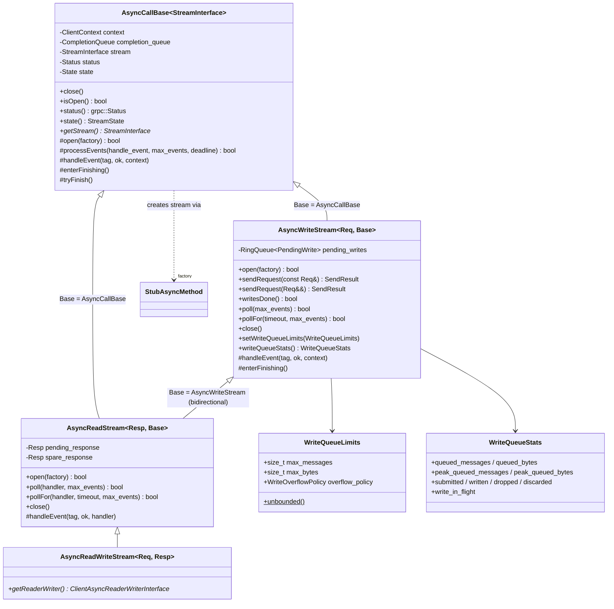
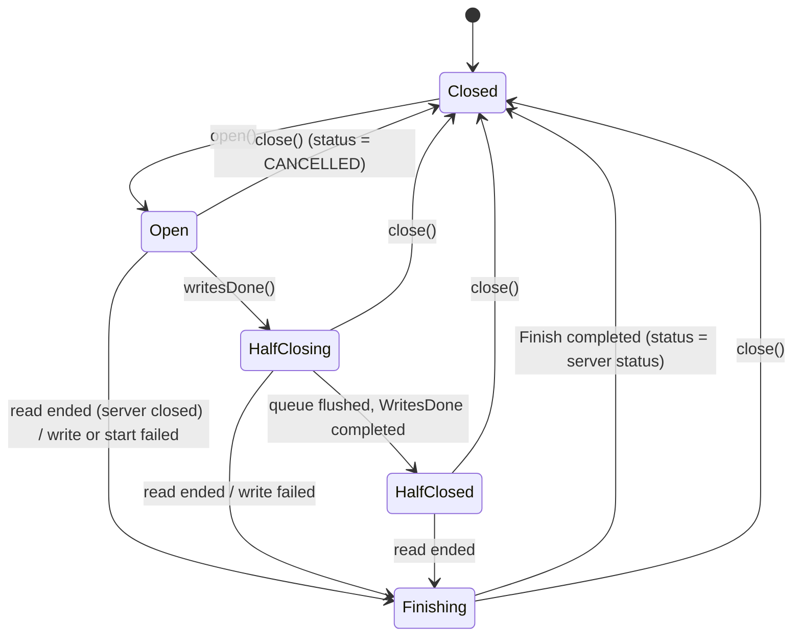
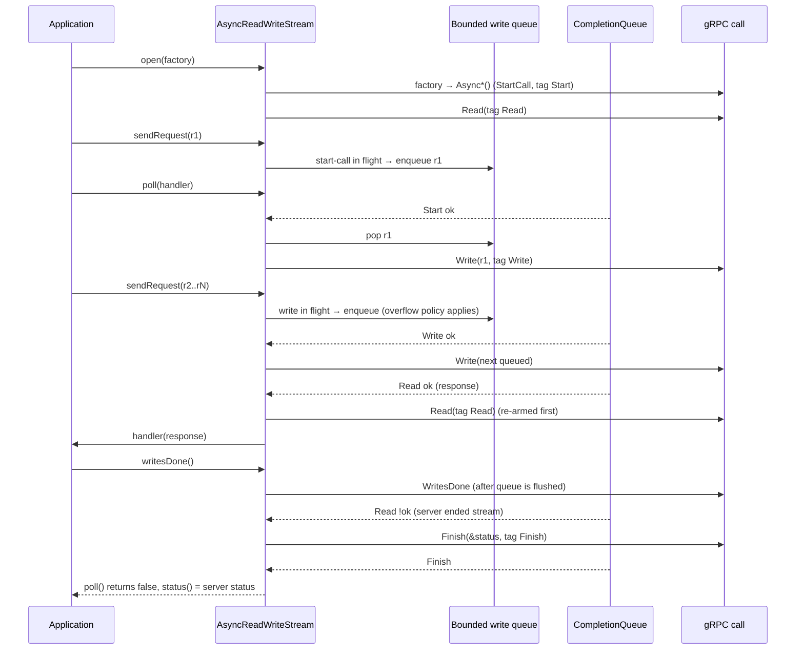

# GRPC Async Stream

A header-only C++20 utility that wraps the gRPC asynchronous client streams — **bidirectional**
(`grpc::ClientAsyncReaderWriterInterface`), **client-streaming** (`grpc::ClientAsyncWriterInterface`) and
**server-streaming** (`grpc::ClientAsyncReaderInterface`) — behind a small, single-threaded, poll-driven API.
It owns the completion queue, the operation tags, write serialization, half-close and the final
`Finish`, so that application code only has to say *how to open the call* and *what to do with each
response*.

Requests sent faster than the network (or the server) can take them are kept in a **bounded write
queue**: once its message or byte limit is reached, excess requests are discarded according to a
configurable overflow policy, so memory use stays bounded however heavy the load is.

```cpp
#include <grpc_utils/AsyncReadWriteStream.h>

grpc_utils::AsyncReadWriteStream<ChatRequest, ChatResponse> stream;

stream.open([&](grpc::ClientContext* ctx, grpc::CompletionQueue* cq, void* tag) {
    ctx->AddMetadata("authorization", token);
    return stub->AsyncOpenChatStream(ctx, cq, tag);
});

stream.sendRequest(request); // never blocks

while (stream.poll([&](ChatResponse&& response) { // never blocks
    handle(std::move(response));
}))
{
    doOtherWork();
}
if (!stream.status().ok()) {
    /* inspect error */
}
```

For client-streaming calls (many requests, one response), `AsyncWriteStream` offers the same write
side without the read side, and for server-streaming calls (one request, many responses)
`AsyncReadStream` offers the read side without the write side:

```cpp
#include <grpc_utils/AsyncWriteStream.h>

UploadSummary summary; // receives the response; must outlive the call
grpc_utils::AsyncWriteStream<UploadChunk> upload;

upload.open([&](grpc::ClientContext* ctx, grpc::CompletionQueue* cq, void* tag) {
    return stub->AsyncUpload(ctx, &summary, cq, tag);
});
upload.sendRequest(chunk); // never blocks
upload.writesDone();       // flushes the queue, then half-closes
while (upload.poll()) {    // never blocks
    doOtherWork();
}
if (upload.status().ok()) {
    use(summary);
}
```

```cpp
#include <grpc_utils/AsyncReadStream.h>

grpc_utils::AsyncReadStream<PriceUpdate> prices;

prices.open([&](grpc::ClientContext* ctx, grpc::CompletionQueue* cq, void* tag) {
    return stub->AsyncSubscribe(ctx, subscription, cq, tag); // the request is serialized right away
});
while (prices.poll([&](PriceUpdate&& update) { apply(update); })) { // never blocks
    doOtherWork();
}
```

---

## Contents

- [Features](#features)
- [Architecture](#architecture)
- [Data flow](#data-flow)
- [Bounded write queue](#bounded-write-queue)
- [API reference](#api-reference)
- [Building](#building)
- [Platform support and memory checks](#platform-support-and-memory-checks)
- [Tests](#tests)
- [Benchmarks](#benchmarks)
- [Test utilities for your own tests](#test-utilities-for-your-own-tests)
- [Using the library in your project](#using-the-library-in-your-project)
- [Project layout](#project-layout)
- [Similar projects](#similar-projects)

---

## Features

- **Header-only**, one header per call type over a shared call core:
  [`AsyncWriteStream.h`](include/grpc_utils/AsyncWriteStream.h) (client-streaming RPCs),
  [`AsyncReadStream.h`](include/grpc_utils/AsyncReadStream.h) (server-streaming RPCs) and
  [`AsyncReadWriteStream.h`](include/grpc_utils/AsyncReadWriteStream.h) (bidirectional-streaming RPCs), with
  [`AsyncCallBase.h`](include/grpc_utils/AsyncCallBase.h) holding what they share; works with any protobuf
  request/response pair.
- **Reusable test utilities** ([`include/grpc_test_utils`](include/grpc_test_utils), CMake target
  `GrpcAsyncStream::TestUtils`): a deterministic fake of the gRPC stream, an in-process gRPC server,
  polling helpers and readable test output, for the tests of products built on the library.
- **Modern C++20**: concepts constrain the message types, the stream factory and the response handler
  (clear compile errors instead of template noise), limits are configured with designated
  initializers, and defaulted `operator==` makes settings and statistics easy to compare.
- **No dependencies beyond gRPC**: the header uses only gRPC and the standard library. Its
  enumerations (`SendResult`, `WriteOverflowPolicy`, `StreamState`) are plain `enum class`es, so any
  enum-reflection library can name them; the test utilities use
  [magic_enum](https://github.com/Neargye/magic_enum) for that.
- **Cross-platform**: Linux (GCC, Clang), macOS (Apple Clang) and Windows (MSVC), built and tested in CI.
- **Non-blocking**: `sendRequest()` and `poll()` never block; `pollFor()` optionally waits for the
  first event so a dedicated stream thread does not have to spin.
- **Correct gRPC async usage**: at most one outstanding write, no write before the start-call has
  completed, exactly one outstanding read for the whole call, `Finish` issued exactly once after all
  other operations completed, and the completion queue drained before anything it references is
  destroyed.
- **Bounded memory under load**: write queue limited by message count *and* total serialized bytes,
  with `DropOldest` / `DropNewest` overflow policies, limits adjustable at run time.
- **Observability**: per-call `WriteQueueStats` (queued, peak, submitted, written, dropped, discarded)
  with a documented accounting invariant.
- **Clean shutdown**: `close()` (and the destructor) cancel the call and release all resources;
  the same object can be reopened for a new call any number of times.
- Comprehensive **Catch2 test suite** (deterministic fake-stream tests + real in-process gRPC server
  tests) and **Catch2 benchmarks** measuring latency, throughput, queue costs and memory under heavy load.

---

## Architecture



The three stream classes are built from three layers by **single inheritance**, each layer taking the
class below it as its `Base` template parameter, so every stream object holds exactly one call core:

| Stream | Layers (top → bottom) |
|---|---|
| `AsyncWriteStream<Req>` | `AsyncWriteStream` → `detail::AsyncCallBase<ClientAsyncWriterInterface<Req>>` |
| `AsyncReadStream<Resp>` | `AsyncReadStream` → `detail::AsyncCallBase<ClientAsyncReaderInterface<Resp>>` |
| `AsyncReadWriteStream<Req, Resp>` | `AsyncReadStream` → `AsyncWriteStream` → `detail::AsyncCallBase<ClientAsyncReaderWriterInterface<Req, Resp>>` |

- **`detail::AsyncCallBase`** — the call core: the gRPC objects below, the call state, the final status,
  `close()`, the event loop, and `Finish`, issued exactly once when the call is ending and no start-call,
  read or write is outstanding.
- **`AsyncWriteStream`** — the write side: the bounded write queue, one outstanding write, no write
  before the start-call has completed, and half-close.
- **`AsyncReadStream`** — the read side: one read outstanding for the whole call, and the response handler
  of `poll()` / `pollFor()`. In `AsyncReadWriteStream` it hides the handler-less `poll()` of the write
  side, so responses cannot be ignored by mistake.

The layers cooperate **without virtual functions** (none of the classes is polymorphic). Each layer extends
`open()`, `close()` and `handleEvent()` by calling the version of the layer below it (`Base::`) and adding its
own part. A layer handles the completions of its own operations and passes the others down, so the chain
is resolved at compile time. The write side also extends `enterFinishing()` to discard its queue; it
therefore always sits directly on the core, below the read side, and the class templates check this
ordering with constraints.

Every call owns three gRPC objects, created by `open()` and destroyed by `close()` in dependency order
(stream → completion queue → context):

| Object | Purpose |
|---|---|
| `grpc::ClientContext` | Per-call context. A fresh one per call (contexts must never be reused). The stream factory may set metadata, deadline, compression, … on it. |
| `grpc::CompletionQueue` | Private to the stream, so operation tags can be small integers (`Start`, `Read`, `Write`, `WritesDone`, `Finish`) instead of pointers. |
| `ClientAsyncReaderWriterInterface` / `ClientAsyncWriterInterface` / `ClientAsyncReaderInterface` | The call itself, created by the user-supplied factory with the `Async*` stub method (which issues `StartCall`). |

### Call state machine



- `canWrite()` is true only in `Open`; `isOpen()` is true in every state but `Closed`.
- Entering `Finishing` discards any queued requests (they could no longer be delivered) and issues
  `Finish` as soon as no read or write is outstanding.
- A write-only `AsyncWriteStream` has no read side: once `WritesDone` completes it goes straight from
  `HalfClosing` to `Finishing` and requests the final status and the response. The server can end a
  client-streaming call only by returning its status, which the client receives with `Finish`, so an
  idle write stream notices an early end with its next write (which fails) or with `writesDone()`.
- A read-only `AsyncReadStream` has no write side and never half-closes: it goes from `Open` to
  `Finishing` when the server ends the stream (or the start-call fails), and requests `Finish` once the
  start-call has completed.

### Threading model

The classes are **not thread-safe** by design: all methods must be called from one thread (typically
the thread that owns the protocol logic, or a dedicated stream thread looping on `pollFor()`).
This keeps the implementation lock-free and makes the handler re-entrancy rules simple: the response
handler runs inside `poll()` and may call `sendRequest()`, `writesDone()` or `close()`.

---

## Data flow



**Write path.** `sendRequest()` writes immediately when the write slot is free; otherwise the request
goes into the bounded queue. The write slot is busy from `open()` until the start-call completes
(the initial metadata shares gRPC's internal write operation set, and a premature `Write` would fail
with `GRPC_CALL_ERROR_TOO_MANY_OPERATIONS`), during every `Write`, and during `WritesDone`.
Whenever a write completes successfully, the next queued request is written, or the pending
half-close is issued, or `Finish` is attempted when the call is ending. gRPC serializes a request
within `Write()` and keeps no reference to it, so the stream keeps no copy of the request being
written: a request sent while the write slot is free is written straight from the caller's object,
without being copied or moved, and a queued request is written straight from its queue slot, which
is destroyed right after. The stream takes a request (copying an lvalue, moving an rvalue) only when it
has to queue it; a request that is dropped is never copied.

**Read path.** Exactly one `Read` is outstanding for the whole call. On completion the message is
moved out of the read buffer, the next `Read` is armed, and only then is the handler invoked, so the
handler may keep the message and may call back into the stream. The next `Read` goes into a spare
buffer holding the cleared message of the previous response: a handler that does not take the message
saves gRPC from reallocating its string, bytes and repeated fields for every response. At most one such
spare message is kept while the call is open; `close()` releases both buffers.

**End of call.** A failed read means the server ended the stream (or the call broke). The stream
stops accepting writes, discards queued requests and calls `Finish` once no write is outstanding;
`poll()` returns `false` after the `Finish` completion and `status()` holds the server's status.
`close()` cancels the call (`TryCancel`), shuts down and drains the completion queue, and sets the
status to `CANCELLED`.

---

## Bounded write queue

gRPC allows only one write in flight per call. If the application produces requests faster than they
are written — because the network is slow, the server reads slowly and HTTP/2 flow control pushes
back, or the connection stalls — every extra request has to be buffered. An unbounded buffer turns
a slow consumer into unbounded memory growth and, eventually, an out-of-memory crash.
`AsyncReadWriteStream` therefore buffers requests in a queue bounded by:

| Limit | Default | Meaning |
|---|---|---|
| `max_messages` | `1024` | Maximum number of queued requests. `0` disables buffering (a request is accepted only if it can be written immediately). |
| `max_bytes` | `64 MiB` | Maximum total serialized size (`ByteSizeLong()`) of queued requests. |
| `overflow_policy` | `DropOldest` | What to discard when a new request does not fit. |

Whichever limit is reached first triggers the overflow policy:

- **`DropOldest`** – evicts as many of the oldest queued requests as needed to fit the new one
  (`SendResult::QueuedDroppedOldest`). Keeps the freshest data; best for telemetry, positions,
  state updates where only recent values matter.
- **`DropNewest`** – rejects the new request (`SendResult::Dropped`) and keeps what is queued.
  Preserves ordering of the earliest data; best when the beginning of a sequence matters more.

A request whose own size exceeds `max_bytes` is always dropped (it could never fit). Limits can be
changed at any time with `setWriteQueueLimits()`; tightening them immediately trims the queue using
the configured policy. `WriteQueueLimits::unbounded()` restores unlimited buffering.

**Memory guarantee.** The memory held by the stream for outgoing requests is at most
`max_bytes` (queued requests, serialized-size measure) plus the per-entry container overhead for at
most `max_messages` entries. The request being written is held by gRPC in serialized form, not by the
stream. The queue is a ring buffer that grows by doubling and allocates nothing per request; a request
is destroyed, and its memory freed, as soon as it leaves the queue, and the queue's storage is released
again once a load peak (more than 256 queued requests) is over.

> `ByteSizeLong()` is the serialized size; the in-memory size of a protobuf message is somewhat larger
> (object header, string capacities). Choose `max_bytes` with that margin in mind, or rely on
> `max_messages` when message sizes are uniform.

**Statistics.** `writeQueueStats()` returns counters for the current (or last) call; `open()` resets them:

| Counter | Meaning |
|---|---|
| `queued_messages`, `queued_bytes` | Current queue occupancy |
| `peak_queued_messages`, `peak_queued_bytes` | High-water marks |
| `submitted_messages` | Requests passed to `sendRequest()` while writable |
| `written_messages` | Writes completed successfully |
| `dropped_messages`, `dropped_bytes` | Discarded by the overflow policy |
| `discarded_messages` | Queued or in-flight requests lost because the call ended or was closed |
| `write_in_flight` | A request write is currently outstanding |

Invariant (checked by the tests):
`submitted == written + dropped + discarded + queued + (write_in_flight ? 1 : 0)`.

---

## API reference

All types live in namespace `grpc_utils`.

### `AsyncWriteStream<RequestProto>`

Header `<grpc_utils/AsyncWriteStream.h>`. A client-streaming call: the same write side, queue, states and
statistics as `AsyncReadWriteStream` (see its table below), without reads.

| Member | Description |
|---|---|
| `template<F> bool open(F&& factory)` | Like `AsyncReadWriteStream::open()`, but the factory returns `std::unique_ptr<ClientAsyncWriterInterface<Req>>`, e.g. `stub->AsyncUpload(ctx, &response, cq, tag)`. The `response` message passed to the stub must outlive the call (until `poll()` returns `false`, or `close()`, `open()` or the destructor returns); it holds the server response once the call has ended with an `OK` status. |
| `bool poll(size_t max_events = 64)` / `template<Rep, Period> bool pollFor(duration timeout, size_t max_events = 64)` | Process the completions of the start-call, writes, half-close and `Finish`, without and with waiting. Return `false` once the call has ended. |
| `bool writesDone()` | Flushes the queued requests, half-closes, then requests the final status and the response. |
| `sendRequest()`, `close()`, `isOpen()`, `canWrite()`, `isWriteInProgress()`, `state()`, `status()`, `getStream()`, `writeQueueLimits()`, `setWriteQueueLimits()`, `writeQueueStats()` | As for `AsyncReadWriteStream`. |

### `AsyncReadStream<ResponseProto>`

Header `<grpc_utils/AsyncReadStream.h>`. A server-streaming call: one request, many responses.

| Member | Description |
|---|---|
| `AsyncReadStream()` | Creates a closed stream. Non-copyable, non-movable. |
| `template<F> bool open(F&& factory)` | Closes any previous call and opens a new one: the factory returns `std::unique_ptr<ClientAsyncReaderInterface<Resp>>`, e.g. `stub->AsyncSubscribe(ctx, request, cq, tag)` (the request is serialized right away and need not outlive the call). Starts reading immediately. Returns `false` (status `INTERNAL`) if the factory returns null. |
| `template<H> bool poll(H&& handler, size_t max_events = 64)` / `template<H, Rep, Period> bool pollFor(H&& handler, duration timeout, size_t max_events = 64)` | As for `AsyncReadWriteStream`: `handler(ResponseProto&&)` is called per received message and may call `close()`. Return `false` once the call has ended. |
| `void close()`, `bool isOpen() const`, `StreamState state() const`, `const grpc::Status& status() const`, `getStream()` | As for `AsyncReadWriteStream`. |

### `AsyncReadWriteStream<RequestProto, ResponseProto>`

Header `<grpc_utils/AsyncReadWriteStream.h>` (includes the other headers). Derives from
`AsyncReadStream<ResponseProto, AsyncWriteStream<RequestProto, detail::AsyncCallBase<ClientAsyncReaderWriterInterface<RequestProto, ResponseProto>>>>`
(see [Architecture](#architecture)), so it has the members of both.

| Member | Description |
|---|---|
| `AsyncReadWriteStream()` / `explicit AsyncReadWriteStream(const WriteQueueLimits&)` | Creates a closed stream with default or given queue limits. Non-copyable, non-movable. |
| `template<F> bool open(F&& factory)` | Closes any previous call, creates a fresh context and completion queue, and calls `factory(grpc::ClientContext*, grpc::CompletionQueue*, void* tag)`, which must return `std::unique_ptr<ClientAsyncReaderWriterInterface<Req, Resp>>` from an `Async*` stub method. Returns `false` (status `INTERNAL`) if the factory returns null. Resets the statistics. |
| `SendResult sendRequest(const RequestProto&)` / `SendResult sendRequest(RequestProto&&)` | Writes the request or queues it (see the bounded queue). Never blocks. A request written at once is not copied; an lvalue is copied (an rvalue moved) only when it is queued. |
| `bool writesDone()` | Half-closes the client side after the queued requests are flushed. `false` if not in `Open` state. |
| `template<H> bool poll(H&& handler, size_t max_events = 64)` | Processes up to `max_events` already available events without waiting. Calls `handler(ResponseProto&&)` per received message. Returns `false` once the call has ended. |
| `template<H, Rep, Period> bool pollFor(H&& handler, duration timeout, size_t max_events = 64)` | Like `poll()`, but waits up to `timeout` for the first event. |
| `void close()` | Cancels the call if active (status `CANCELLED`), discards queued requests and releases all resources. Also called by the destructor. |
| `bool isOpen() const` | A call is active (any state but closed). |
| `bool canWrite() const` | New requests are accepted (open and not half-closed/ending). |
| `bool isWriteInProgress() const` | A start-call, write or half-close is outstanding. |
| `StreamState state() const` | Current call state: `Closed`, `Open`, `HalfClosing`, `HalfClosed` or `Finishing` (see the state machine), for diagnostics and logging. |
| `const grpc::Status& status() const` | Final status of the last call; `OK` while active. |
| `const WriteQueueLimits& writeQueueLimits() const` / `void setWriteQueueLimits(const WriteQueueLimits&)` | Queue limits; see above. |
| `const WriteQueueStats& writeQueueStats() const` | Queue statistics; see above. |
| `AsyncReaderWriterInterface* getReaderWriter() const` / `getStream()` | The underlying gRPC stream (e.g. for `ReadInitialMetadata`-free advanced use); null when closed. |

### Concepts

The class and its member templates are constrained, so a wrong argument is reported at the call site:

| Concept | Requirement |
|---|---|
| `ProtobufMessage<M>` | Default-constructible, movable, with `ByteSizeLong()` and `Clear()`: any protobuf message. Constrains `RequestProto` and `ResponseProto`. |
| `AsyncWriterInterfaceFor<S, Req>` | `S` has `Write(const Req&, void*)`, `WritesDone(void*)` and `Finish(grpc::Status*, void*)`: `ClientAsyncWriterInterface<Req>` and `ClientAsyncReaderWriterInterface<Req, Resp>`. Constrains the `StreamInterface` of `AsyncWriteStream`. |
| `AsyncReaderInterfaceFor<S, Resp>` | `S` has `Read(Resp*, void*)` and `Finish(grpc::Status*, void*)`: `ClientAsyncReaderInterface<Resp>` and `ClientAsyncReaderWriterInterface<Req, Resp>`. Constrains the stream interface of `AsyncReadStream`. |
| `AsyncStreamFactoryFor<F, S>` | Callable as `f(grpc::ClientContext*, grpc::CompletionQueue*, void*)`, returning something convertible to `std::unique_ptr<S>`. Constrains `open()` of every stream. |
| `StreamFactoryFor<F, Req, Resp>` | `AsyncStreamFactoryFor` with the bidirectional interface: callable as `f(grpc::ClientContext*, grpc::CompletionQueue*, void*)`, returning something convertible to `std::unique_ptr<grpc::ClientAsyncReaderWriterInterface<Req, Resp>>`. Constrains `open()`. |
| `ResponseHandlerFor<H, Resp>` | Callable with `Resp&&` (taking `Resp&&`, `const Resp&` or `Resp` by value all work). Constrains `poll()` and `pollFor()`. |

### Helpers

| Helper | Description |
|---|---|
| `constexpr bool isAccepted(SendResult)` | True for `Written`, `Queued`, `QueuedDroppedOldest`. |
| `WriteQueueStats::isConsistent()` | Checks the accounting invariant below. |
| `operator==` on `WriteQueueLimits`, `WriteQueueStats` | Defaulted member-wise comparison. |
| `static constexpr WriteQueueLimits::unbounded()` | No limits (the behaviour before the bounded queue). |

The library deliberately has no enum-to-string functions, to keep the header free of dependencies.
To log or parse its enumerations, use an enum-reflection library such as
[magic_enum](https://github.com/Neargye/magic_enum) (as the test utilities do), or a `switch`
of your own:

```cpp
#include <magic_enum/magic_enum.hpp>

// Names for logging
log("send result: {}, state: {}", magic_enum::enum_name(stream.sendRequest(request)),
    magic_enum::enum_name(stream.state()));

// Parse the overflow policy from configuration, falling back to the default
const auto policy = magic_enum::enum_cast<grpc_utils::WriteOverflowPolicy>(config["overflow_policy"])
                        .value_or(grpc_utils::WriteOverflowPolicy::DropOldest);

// Count sendRequest() outcomes per result
std::array<std::uint64_t, magic_enum::enum_count<grpc_utils::SendResult>()> outcomes{};
++outcomes[*magic_enum::enum_index(stream.sendRequest(request))];
```

### `SendResult`

| Value | Meaning | `isAccepted()` |
|---|---|---|
| `Written` | Write started immediately | ✔ |
| `Queued` | Buffered, will be written later | ✔ |
| `QueuedDroppedOldest` | Buffered after evicting older requests | ✔ |
| `Dropped` | Discarded: queue full with `DropNewest`, request larger than `max_bytes`, or buffering disabled | ✘ |
| `NotWritable` | Stream not open, half-closed or ending | ✘ |

`constexpr bool isAccepted(SendResult)` returns true for the first three.

> **Header location (2.0):** include `<grpc_utils/AsyncReadWriteStream.h>` instead of `<AsyncReadWriteStream.h>`.
>
> **Migrating to 2.0:** the header now requires C++20 (it uses concepts, `using enum` and designated
> initializers); build with `-std=c++20` / `/std:c++20` or later, and the root namespace was renamed from
> `Network` to `grpc_utils` (replace `Network::` with `grpc_utils::`). The API is otherwise unchanged from 1.1.
>
> **Migrating from 1.0:** `sendRequest()` used to return `bool` (`false` = not writable).
> Replace `if (!stream.sendRequest(r))` with `if (!grpc_utils::isAccepted(stream.sendRequest(r)))`,
> or compare with `SendResult::NotWritable` to keep the exact old meaning. The write queue used to be
> unbounded; construct the stream with `WriteQueueLimits::unbounded()` for the old behaviour.

### Typical patterns

```cpp
// Dedicated stream thread: no busy loop
while (stream.pollFor(onResponse, std::chrono::milliseconds(50)))
    drainOutgoingMessagesInto(stream);

// Graceful end: flush, half-close, wait for the server to finish the call
stream.writesDone();
while (stream.pollFor(onResponse, std::chrono::milliseconds(100))) {}
log(stream.status());

// Telemetry: keep at most ~1 s of 100 Hz samples, newest data wins
grpc_utils::AsyncReadWriteStream<Sample, Ack> telemetry({
    .max_messages    = 100,
    .max_bytes       = 1 << 20,
    .overflow_policy = grpc_utils::WriteOverflowPolicy::DropOldest,
});

// Only change what differs from the defaults (1024 messages, 64 MiB, DropOldest)
stream.setWriteQueueLimits({.overflow_policy = grpc_utils::WriteOverflowPolicy::DropNewest});

// Client-streaming upload with a deadline: the response arrives with the final status
UploadSummary summary;
grpc_utils::AsyncWriteStream<UploadChunk> upload({.max_messages = 64});
upload.open([&](grpc::ClientContext* ctx, grpc::CompletionQueue* cq, void* tag) {
    ctx->set_deadline(std::chrono::system_clock::now() + std::chrono::seconds(30));
    return stub->AsyncUpload(ctx, &summary, cq, tag);
});
for (const UploadChunk& chunk : chunks)
    upload.sendRequest(chunk);
upload.writesDone();
while (upload.pollFor(std::chrono::milliseconds(100))) {}
```

---

## Building

### Requirements

- CMake ≥ 3.25, including CMake 4.x. (gRPC's bundled c-ares still declares CMake 3.1 compatibility,
  which CMake 4 rejects; the build raises `CMAKE_POLICY_VERSION_MINIMUM` to 3.5 for the gRPC subtree only.)
- A C++20 compiler with concepts, ranges and `using enum`:
  GCC ≥ 11, Clang ≥ 16, Apple Clang ≥ 15 (Xcode 15), MSVC ≥ 19.30 (Visual Studio 2022).
  The library header alone needs less (GCC 11, Clang 13, MSVC 19.29); the newer versions are for
  the ranges used by the tests and benchmarks.
- gRPC. Test utilities only: [magic_enum](https://github.com/Neargye/magic_enum). This project's tests
  and benchmarks also use [Catch2](https://github.com/catchorg/Catch2). The library header itself needs
  nothing but gRPC. Each dependency is taken, in this order, from
  1. targets already imported into the build (e.g. by [Conan](#dependencies-from-conan)'s CMakeDeps, or by a parent project),
  2. an installed package found with `find_package(<Name> CONFIG)` (Conan, vcpkg, Homebrew, a custom prefix),
  3. otherwise it is downloaded and built with [CPM.cmake](https://github.com/cpm-cmake/CPM.cmake)
     (network access on the first configure).

  The configure output says which source each one came from (`using imported|package|fetched ...`).

### Quick start

```bash
# Optional but recommended: share downloaded sources between build directories
export CPM_SOURCE_CACHE=$HOME/.cache/CPM

cmake -S . -B build -G Ninja -DCMAKE_BUILD_TYPE=Release
cmake --build build
ctest --test-dir build -LE benchmark --output-on-failure      # unit + integration tests
./build/benchmarks/GrpcAsyncStreamBenchmarks "[benchmark]"     # all benchmarks
```

### CMake presets

[`CMakePresets.json`](CMakePresets.json) defines four build configurations, each in two families that differ
only in where the dependencies come from. All of them use the Ninja generator on Linux, macOS and Windows,
each in its own build directory `build-<preset>`:

| Configuration | `CMAKE_BUILD_TYPE` | CPM preset | Conan preset |
|---|---|---|---|
| Release: optimized, no debug information | `Release` | `cpm-release` | `conan-release` |
| RelWithDebInfo: optimized, with debug information | `RelWithDebInfo` | `cpm-relwithdebinfo` | `conan-relwithdebinfo` |
| RelWithSanitizers: `GRPC_ASYNC_STREAM_ENABLE_SANITIZERS=ON`, with assertions (see [memory checks](#platform-support-and-memory-checks)) | `RelWithDebInfo` | `cpm-relwithsanitizers` | `conan-relwithsanitizers` |
| Debug: unoptimized, with debug information | `Debug` | `cpm-debug` | `conan-debug` |

- **`cpm-*`** build gRPC, protobuf, magic_enum and Catch2 from source with CPM
  (`GRPC_ASYNC_STREAM_GRPC_PROVIDER=fetch`), whatever is installed on the machine. They need nothing but
  CMake, a compiler, Ninja and git; set `CPM_SOURCE_CACHE` to share the downloads between build directories.
  The first build of each preset compiles gRPC (see below).
- **`conan-*`** take the dependencies from [Conan 2](https://conan.io) ([`conanfile.py`](conanfile.py)):
  the [cmake-conan](https://github.com/conan-io/cmake-conan) dependency provider
  ([`cmake/conan_provider.cmake`](cmake/conan_provider.cmake), pinned) runs `conan install` during the
  configure step, with a host profile derived from the CMake toolchain, and builds missing packages. They
  need `conan` on `PATH`. `conan-relwithdebinfo` and `conan-relwithsanitizers` build this project as
  RelWithDebInfo over the **Release** packages (`CONAN_INSTALL_BUILD_CONFIGURATIONS=Release`), so they reuse
  the packages of `conan-release`; `conan-debug` installs Debug packages.

Every preset name works for configuring, building and testing, and as a workflow that runs all three. The
test presets exclude the benchmarks, which `<preset>-benchmarks` runs:

```bash
cmake --workflow --preset conan-release     # configure + build + unit and integration tests

cmake --preset cpm-relwithsanitizers        # or step by step
cmake --build --preset cpm-relwithsanitizers
ctest --preset cpm-relwithsanitizers
ctest --preset cpm-relwithsanitizers-benchmarks
```

- Add your own settings on the command line (`cmake --preset cpm-debug -DGRPC_ASYNC_STREAM_GRPC_UNSECURE=OFF`)
  or in a `CMakeUserPresets.json` that inherits from these presets, e.g. one with
  `GRPC_ASYNC_STREAM_GRPC_PROVIDER=package` and `CMAKE_PREFIX_PATH` for an installed gRPC.
- On Windows, run the presets from a Visual Studio developer environment for x64 (see
  [Windows notes](#windows-notes)); Visual Studio and VS Code's CMake Tools set it up themselves from the
  presets' `architecture` (`x64`, external strategy).

With an installed gRPC (e.g. Homebrew `brew install grpc`, vcpkg, or a custom prefix):

```bash
cmake -S . -B build -DGRPC_ASYNC_STREAM_GRPC_PROVIDER=package -DCMAKE_PREFIX_PATH=/opt/homebrew
```

Building gRPC from source compiles ~1000 translation units on the first build (several minutes to tens of
minutes on a laptop); subsequent builds reuse it. Only what the tests link is built: the language plugins
other than `grpc_cpp_plugin`, gRPC's tests and the dependencies' tests and tools are switched off.

As the top-level project, the build uses **`grpc++_unsecure`** (`GRPC_ASYNC_STREAM_GRPC_UNSECURE=ON`):
the tests only need insecure and in-process channels, so gRPC is built without TLS credentials, xDS and
RE2-based policies. That is about a third fewer compilations than the full `grpc++`, and no SSL library at
all: BoringSSL is neither cloned nor built, and a system OpenSSL is not used (so its version does not
matter). With `GRPC_ASYNC_STREAM_GRPC_UNSECURE=OFF` (the default when this project is a subproject) the
full `grpc++` is built, using the system OpenSSL when found, otherwise the bundled BoringSSL. zlib is taken
from the system when found, otherwise built.

### Dependencies from Conan

[`conanfile.py`](conanfile.py) declares all dependencies for [Conan 2](https://conan.io): gRPC 1.72.0
(with protobuf), magic_enum 0.9.8 and Catch2 3.8.1. Conan's `CMakeDeps` generates package configs
that the dependency lookup above finds, so nothing is fetched with CPM. The `conan-*`
[presets](#cmake-presets) run `conan install` themselves; the recipe also works on its own, with the
toolchain it generates:

```bash
conan install . --build=missing -s compiler.cppstd=20 -s build_type=Release
cmake -S . -B build/Release -G Ninja -DCMAKE_BUILD_TYPE=Release \
      -DCMAKE_TOOLCHAIN_FILE=build/Release/generators/conan_toolchain.cmake
cmake --build build/Release
ctest --test-dir build/Release -LE benchmark --output-on-failure
```

- `-s compiler.cppstd=20` (or `gnu20`) is required and checked by the recipe (the presets' provider takes it
  from `CMAKE_CXX_STANDARD`): Abseil's ABI depends on the
  C++ standard, so gRPC, protobuf and Abseil must be built with the same standard as this project.
  Conan Center's prebuilt binaries mostly use C++17, so expect `--build=missing` to build gRPC once;
  Conan's package cache keeps it for later builds.
- The generated toolchain and the `conan-*` presets set `GRPC_ASYNC_STREAM_GRPC_PROVIDER=package`, so a
  missing package is an error rather than a silent fallback to building gRPC with CPM.
- The recipe does not generate a `CMakeUserPresets.json`: its preset names would clash with the `conan-*`
  presets of the project. Delete one left by an earlier `conan install` if CMake reports duplicate presets.
- Recipe options: `-o "&:with_tests=False"` (no Catch2, no tests or benchmarks), `-o "&:with_test_utils=False"`.
- `protoc` and `grpc_cpp_plugin` come from the host packages in native builds. When cross-building, the
  recipe adds them as tool requirements; the lookup then finds them on `PATH` (Conan's build environment).

**In your own Conan-based project**, just require `grpc` (and `magic_enum` for the test utilities) in
your recipe and add this project as a subdirectory or with CPM: when the targets are already imported or
the packages are found, they are used as they are.

### CMake options

| Option | Default | Description |
|---|---|---|
| `GRPC_ASYNC_STREAM_GRPC_PROVIDER` | `auto` | `auto`: imported targets or installed package (e.g. from Conan) if available, else fetch; `package`: require imported targets or an installed package; `fetch`: build from source, unless gRPC targets are already imported |
| `GRPC_ASYNC_STREAM_GRPC_UNSECURE` | `ON` (top level) | When gRPC is built from source, link `grpc++_unsecure` (no TLS, xDS, RE2) and skip BoringSSL/OpenSSL; no effect on a gRPC package |
| `GRPC_ASYNC_STREAM_GRPC_VERSION` | `1.71.0` | gRPC version fetched when building from source |
| `GRPC_ASYNC_STREAM_CATCH2_VERSION` | `3.8.1` | Catch2 version fetched when no imported targets or installed package is found |
| `GRPC_ASYNC_STREAM_BUILD_TEST_UTILS` | `ON` (top level) | Provide the `GrpcAsyncStream::TestUtils` target; switched on automatically when this project's tests or benchmarks are built |
| `GRPC_ASYNC_STREAM_MAGIC_ENUM_VERSION` | `0.9.8` | magic_enum version used by the test utilities (fetched when no installed package is found) |
| `GRPC_ASYNC_STREAM_BUILD_TESTS` | `ON` (top level) | Build the test suite |
| `GRPC_ASYNC_STREAM_BUILD_BENCHMARKS` | `ON` (top level) | Build the benchmarks |
| `GRPC_ASYNC_STREAM_ENABLE_WARNINGS` | `ON` (top level) | `-Wall -Wextra -Wpedantic -Wshadow -Wconversion -Werror` (or `/W4 /WX`) for project code |
| `GRPC_ASYNC_STREAM_ENABLE_SANITIZERS` | `OFF` | Build tests/benchmarks with the sanitizers the toolchain supports (see [Platform support](#platform-support-and-memory-checks)) |
| `GRPC_ASYNC_STREAM_GRPC_ASAN_INSTRUMENTED` | `OFF` | The linked gRPC is built with ASan; don't define `GRPC_ASAN_SUPPRESSED` in sanitizer builds |
| `GRPC_ASYNC_STREAM_HEAP_TRACKING` | `ON` | Track the C++ heap in the benchmarks; switched off automatically in sanitizer builds |
| `GRPC_ASYNC_STREAM_INSTALL` | `ON` (top level) | Install rules and package config (only when gRPC is an installed package) |

When the project is consumed as a subproject, tests, benchmarks, warnings and install rules are off by default.

The whole build (gRPC, protobuf and Abseil included) uses one C++ standard, C++20 at minimum:
Abseil's ABI depends on the standard, so mixing a C++17-built Abseil with C++20 code is unsafe.
When using an installed gRPC (including from Conan, with `-s compiler.cppstd=20`), make sure it was
built with C++20 as well, or use `GRPC_ASYNC_STREAM_GRPC_PROVIDER=fetch`.

### Windows notes

- Build from a *Developer Command Prompt / PowerShell for VS 2022* (or with `ilammy/msvc-dev-cmd` in CI);
  the Ninja generator is recommended, Visual Studio generators work too.
- gRPC's sources have deep paths: put the CPM cache close to the drive root
  (`set CPM_SOURCE_CACHE=C:\cpm`) or enable long paths (`git config --system core.longpaths true`).
- When BoringSSL is built (`GRPC_ASYNC_STREAM_GRPC_UNSECURE=OFF` without a system OpenSSL), its assembly
  needs [NASM](https://www.nasm.us/); without it the build uses the portable C implementation
  (`OPENSSL_NO_ASM`) automatically.
- All libraries use the dynamic MSVC runtime (`/MD`); the test targets add `/permissive- /Zc:__cplusplus
  /Zc:preprocessor /utf-8 /bigobj`, `NOMINMAX`, `WIN32_LEAN_AND_MEAN` and `_WIN32_WINNT=0x0A00`.

---

## Platform support and memory checks

| | Linux GCC / Clang | macOS Apple Clang | Windows MSVC | MinGW |
|---|---|---|---|---|
| Library, tests, benchmarks | ✔ | ✔ | ✔ | builds, not in CI |
| Warnings as errors | `-Wall -Wextra -Wpedantic -Wshadow -Wconversion` | same (`-Wno-sign-conversion`) | `/W4`, third-party headers external | same as GCC |
| AddressSanitizer | ✔ | ✔ | ✔ `/fsanitize=address` | ✘ (option ignored) |
| UndefinedBehaviorSanitizer | ✔ | ✔ | ✘ not available | ✘ |
| LeakSanitizer | ✔ | ✘ not supported, `detect_leaks=0` | ✘ | ✘ |
| Container-overflow checks | ✘ `detect_container_overflow=0` | ✘ `detect_container_overflow=0` | ✘ `detect_container_overflow=0`, `_DISABLE_{VECTOR,STRING,OPTIONAL}_ANNOTATION` | ✘ |
| Benchmark heap tracking | ✔ | ✔ | ✔ | ✔ |
| Benchmark RSS | ✔ `/proc/self/statm` | ✔ `task_info` | ✔ `GetProcessMemoryInfo` | ✔ |

Notes:

- Only this project's code is instrumented by the sanitizers; gRPC and its dependencies are built
  normally. Checks that need *every* object instrumented are therefore disabled where they would fail
  or report false positives: MSVC's STL annotations make the linker reject mixed objects (LNK2038), and
  container-overflow detection misfires when plain library code fills containers whose spare capacity
  instrumented code has poisoned: libc++ containers modified by gRPC on macOS, or a protobuf
  `RepeatedField` grown by the inline code of a generated message and filled by the plain protobuf parser.
  CTest therefore runs the tests with `detect_container_overflow=0` on every platform.
- With GCC/Clang, sanitizer builds define `GRPC_ASAN_SUPPRESSED`. gRPC's public headers change struct
  layouts when they detect ASan: the pthread-based `gpr_mu` gains a `leak_checker` pointer. On macOS
  (where gRPC does not use Abseil's mutex) that makes `grpc::CompletionQueue`, `grpc::Server` and friends
  8 bytes larger in instrumented code than in the plain gRPC library — an ODR violation that shows up as
  a `heap-buffer-overflow` in `CompletionQueue`'s constructor and crashes in `~ServerContextBase`.
  If your gRPC is itself built with `-fsanitize=address`, set `GRPC_ASYNC_STREAM_GRPC_ASAN_INSTRUMENTED=ON`.
  Product tests that use `GrpcAsyncStream::TestUtils` with ASan against a plain gRPC need the same define.
- Sanitizer builds keep assertions active in every configuration: `NDEBUG` is removed from the Release,
  RelWithDebInfo and MinSizeRel flags of this project's code (not of the dependencies).
- Heap tracking replaces the global `operator new/delete`, which sanitizers also take over (and they
  quarantine freed memory), so it is off in sanitizer builds — both by CMake and by a compile-time
  check in `MemoryTracker.cpp`. The heavy-load benchmark then reports heap figures as `n/a`, still
  verifies the queue's own byte and message bounds, and skips the heap comparison with a warning.
- Heap tracking counts the requested bytes of every C++ allocation and keeps each block's size in a
  header in front of it, so it works on every platform and adds no allocator queries (such as `_msize`,
  which takes the heap lock on Windows) to the measured code. Without an RSS API, RSS is reported as `n/a`.
- The test server simulates slow consumers with microsecond delays. `sleep_for` has ~1 ms
  granularity on Windows (and is coarse on macOS), so the last stretch of each delay is spent
  yielding: results are comparable across platforms.

### Continuous integration

[`.github/workflows/ci.yml`](.github/workflows/ci.yml) runs the tests and the heavy-load benchmark on six
configurations, each with a [preset](#cmake-presets): Linux GCC, macOS Apple Clang (arm64) and Windows MSVC
with `conan-release`, and Linux Clang (ASan/UBSan/LSan), macOS Apple Clang (ASan/UBSan) and Windows MSVC
(ASan) with `conan-relwithsanitizers`.

- **Dependencies come from Conan** ([`conanfile.py`](conanfile.py)), installed by the presets' provider
  during the configure step, and the configure step fails if anything is fetched with CPM. Conan Center has
  no prebuilt C++20 binaries of gRPC and Abseil (Abseil's binaries are tied to the C++ standard they were
  built with), so the first run builds them once per dependency set: Linux GCC, Linux Clang, macOS and
  Windows. The Conan package cache, keyed on the detected compiler profile and `conanfile.py`, then lets
  every later run skip the gRPC build entirely. Only finished packages are cached (build trees and sources
  are cleaned), to stay within the cache quota.
- **The dependencies are always Release packages.** `conan-relwithsanitizers` builds this project as
  RelWithDebInfo over them, with assertions kept active and debug information for readable stack traces,
  so each sanitizer job shares its platform's dependency set.
- A seventh job, **Linux GCC (CPM)**, keeps the no-package-manager path covered with `cpm-release`: it
  builds gRPC from source with CPM, using ccache.

---

## Tests

`GrpcAsyncStreamTests` (Catch2, registered with CTest through `catch_discover_tests`) has six suites,
built on the [test utilities](#test-utilities-for-your-own-tests):

| Suite | File | Approach |
|---|---|---|
| `[lifecycle]` | `tests/StreamLifecycleTests.cpp` | State machine driven through a **fake** `ClientAsyncReaderWriterInterface` (`grpc_test_utils/FakeReaderWriter.h`) that completes operations only when the test says so (via `grpc::Alarm` on the stream's completion queue). Deterministic ordering of start, reads, writes, half-close and finish; the fake also records every **gRPC API contract violation** (concurrent writes, write before start-call, Finish with outstanding operations, double Finish, …) and tests assert there are none. |
| `[write-queue]` | `tests/WriteQueueTests.cpp` | Bounded queue: message and byte limits, both overflow policies, oversized requests, zero-capacity queue, run-time limit changes, statistics and the accounting invariant, and a 200 000-request flood proving the queue never exceeds its limits. |
| `[integration]` | `tests/IntegrationTests.cpp` | Real gRPC calls to the repository's test service (`tests/support/TestServer.*`) in an **in-process server** (`grpc_test_utils/InProcessServer.h`): ordered echo of 1000 requests, ping-pong from the handler, client metadata, 5000-response server bursts, server error statuses, server-initiated end, client cancellation observed by the server, deadline expiry, unreachable server, 50 sequential calls on one object, and a slow server under a 20 000 × 1 KiB flood verifying bounded queue occupancy, drop accounting and in-order delivery of everything written. |
| `[write-stream]` | `tests/WriteStreamTests.cpp` | `AsyncWriteStream` for client-streaming calls: the state machine through a fake `ClientAsyncWriterInterface` (no reads, Finish right after the half-close or after a failed write or start-call, close, reopen, bounded queue, no API contract violations), compile-time checks of the class relations and concepts, and `Upload` calls to the in-process test server (all requests in order with the response, empty upload, server errors, early server reply, cancellation, deadline, unreachable server, sequential calls, slow server with a bounded queue). |
| `[read-stream]` | `tests/ReadStreamTests.cpp` | `AsyncReadStream` for server-streaming calls and the composition of the stream classes: compile-time checks of the layering (single inheritance, one core, no polymorphism) and the concepts; the state machine through a fake `ClientAsyncReaderInterface` (request passed to the stub, reading before the start-call completes, end of stream, Finish waiting for the start-call, failed start-call, close, re-entrant close, reopen, no writes); and `Subscribe` calls to the in-process test server (5000-response burst in order, single and empty responses, server errors, cancellation observed by the server, deadline, unreachable server, sequential calls). |
| `[test-utils]` | `tests/TestUtilsUsageTests.cpp` | The test utilities used the way a product's tests would use them, with nothing but `<grpc_utils/…>` and `<grpc_test_utils/…>`: a product message type of its own driven through the fake call, and a generic echo service (no generated code) called through an `InProcessServer`. |

In addition, `GrpcAsyncStreamHeaderChecks` compiles every public header on its own, with the full
warning flags, so each header stays self-contained.

The test protocol (`tests/proto/test_stream.proto`) lets the client drive the server behaviour per
request: `ECHO`, `BURST`, `FAIL` (with status code), `END`, plus a per-request delay; the server can also
be made a slow consumer with `setReadDelay()`. Its client-streaming `Upload` method records the requests
and replies with an `UploadSummary` (count, ids in order, payload bytes, client metadata); its
server-streaming `Subscribe` method answers its single request like `Chat` does.

Over the in-process transport, a write issued after the server has already returned its status stays
pending until the client requests that status, which the gRPC API allows only after the half-close.
Tests of write-only streams in which the server replies early should therefore half-close instead of
writing further; over TCP such writes complete normally.

```bash
ctest --test-dir build -LE benchmark --output-on-failure
./build/tests/GrpcAsyncStreamTests "[write-queue]"     # one suite
./build/tests/GrpcAsyncStreamTests --list-tests
```

Sanitizer build: `cmake --workflow --preset conan-relwithsanitizers` (or `cpm-relwithsanitizers`), or `cmake -S . -B build-asan -DGRPC_ASYNC_STREAM_ENABLE_SANITIZERS=ON -DCMAKE_BUILD_TYPE=Debug`
(the sanitizers and their runtime options are chosen per platform, see the table above; CTest passes the options).

---

## Benchmarks

`GrpcAsyncStreamBenchmarks` uses Catch2's benchmarking support. Benchmarks are hidden test cases,
selected by tag:

| Tag | What is measured |
|---|---|
| `[latency]` | Ping-pong round-trip (send one request, wait for its echo) with 64 B and 16 KiB payloads |
| `[throughput]` | 1000 pipelined echoes with 64 B, 1 KiB and 16 KiB payloads |
| `[read]` | `AsyncReadStream`: a server-streaming call delivering 1000 responses of 64 B, 1 KiB and 16 KiB |
| `[write]` | `AsyncWriteStream`: a client-streaming call sending 1000 requests of 64 B, 1 KiB and 16 KiB, then the half-close and the final status |
| `[queue]` | Cost of `sendRequest()` when enqueueing, rejecting (`DropNewest`, full) and evicting (`DropOldest`, full) |
| `[load]` | Heavy load against a slow server, comparing unbounded and bounded queues: peak C++ heap growth, peak RSS growth, peak queue size/bytes, written/dropped/received counts, mean send cost, produce and drain time, p50/p99 send→echo latency, and a histogram of `sendRequest()` results per `SendResult` |

Memory is measured with `benchmarks/MemoryTracker.cpp`, which (where supported, see
[Platform support](#platform-support-and-memory-checks)) replaces global `operator new/delete`
in the benchmark executable to track live and peak C++ heap bytes exactly, and samples the process RSS
(`/proc/self/statm` on Linux, `task_info` on macOS, `GetProcessMemoryInfo` on Windows).

```bash
./build/benchmarks/GrpcAsyncStreamBenchmarks "[benchmark]" --benchmark-samples 20
./build/benchmarks/GrpcAsyncStreamBenchmarks "[load]"
# Heavy-load scenario parameters
GRPC_ASYNC_STREAM_BENCH_MESSAGES=200000 GRPC_ASYNC_STREAM_BENCH_PAYLOAD=4096 \
GRPC_ASYNC_STREAM_BENCH_SERVER_DELAY_US=50 ./build/benchmarks/GrpcAsyncStreamBenchmarks "[load]"
```

`ctest --test-dir build -L benchmark` runs all of them through CTest.

[docs/Optimizations.md](docs/Optimizations.md) describes how the streams were profiled under heavy load,
the bottlenecks found and the optimizations made, with their measured effect.

### Sample results

Release build, C++20, GCC 13.3, gRPC 1.71.0, Linux x86-64 container with 2 vCPUs; client and server in one
process over an in-process channel. Absolute numbers depend on the machine; the relations between the
configurations are what matters.

**Latency, throughput and queue operations** (mean of 20 samples):

| Benchmark | Mean |
|---|---|
| ping-pong round-trip, 64 B | 141 µs |
| ping-pong round-trip, 16 KiB | 156 µs |
| 1000 pipelined echoes, 64 B / 1 KiB / 16 KiB | 28.6 ms / 31.3 ms / 30.2 ms (≈ 32–35 k msg/s) |
| `sendRequest()` enqueue | 37 ns |
| `sendRequest()` drop newest, queue full | 80 ns |
| `sendRequest()` evict oldest + enqueue, queue full | 87 ns |

**Heavy load**: 50 000 × 1 KiB requests produced as fast as possible (polling every 64 sends)
against a server that consumes at most one request per 20 µs:

| Write queue | Written | Dropped | Peak queue | Peak heap growth | Peak RSS growth | Drain time | p50 / p99 latency |
|---|---:|---:|---:|---:|---:|---:|---:|
| default (1024 msgs / 64 MiB, drop oldest) | 1 796 | 48 204 | 1024 | 1.12 MiB | 1.09 MiB | 89 ms | 11.5 / 87 ms |
| 256 msgs, drop oldest | 1 034 | 48 966 | 256 | 0.28 MiB | 0.18 MiB | 22 ms | 0.4 / 21 ms |
| 256 msgs, drop newest | 805 | 49 195 | 256 | 0.28 MiB | 0.19 MiB | 22 ms | 23 / 28 ms |
| 256 KiB, drop oldest | 1 027 | 48 973 | 253 | 0.28 MiB | 0.19 MiB | 23 ms | 0.4 / 21 ms |
| **unbounded** | 50 000 | 0 | 49 291 | **53.5 MiB** | **54.2 MiB** | **4.9 s** | **2.5 / 4.8 s** |

What the numbers show:

- With an unbounded queue, memory grows linearly with the backlog (≈ 1.1 KiB per pending 1 KiB
  request) — 50× more here, and without limit for a longer or faster producer. Every bounded
  configuration stays at its configured limit regardless of how many requests are produced.
- The backlog also turns into **latency**: unbounded, a request waits seconds behind older ones,
  and closing the stream takes 4.9 s to drain. Bounded queues cap both.
- `DropOldest` delivers the *freshest* data (median latency below 1 ms: most delivered requests were
  produced just before they were written), whereas `DropNewest` delivers the *earliest* data with a
  latency equal to the queue's drain time.
- The cost of the bound itself is negligible: dropping or evicting a request costs 40–50 ns more
  than enqueueing it.

---

## Test utilities for your own tests

The utilities this project's tests are built on are published for the tests of products that use the
library, as the header-only CMake target **`GrpcAsyncStream::TestUtils`** with headers under
`<grpc_test_utils/…>` (namespace `grpc_test_utils`):

| Header | Contents | Needs |
|---|---|---|
| `FakeReaderWriter.h` | `FakeCall<W, R>` with `makeFakeStreamFactory()` (a fake `ClientAsyncReaderWriterInterface`) `makeFakeWriterFactory(call, &response)` (a fake `ClientAsyncWriterInterface` for client-streaming calls; `completeFinish(status, response)` fills the response) and `makeFakeReaderFactory(call, request)` (a fake `ClientAsyncReaderInterface` for server-streaming calls; `initialRequest()` returns the request): start-call, reads, writes, half-close and finish complete only when the test says so, with any outcome. Records the written messages and every misuse of the gRPC async API (`violations()`). | gRPC |
| `InProcessServer.h` | `InProcessServer`: runs any gRPC services (sync, async, callback, generic) in the test process, reachable through in-process channels: no ports, no conflicts between parallel test runs. `makeStub<Service>()`, extra channels with their own arguments, configure hook, idempotent `shutdown()`. Also `unreachable_server_address` for connection-failure tests. | gRPC |
| `StreamTestUtils.h` | `pollUntil()` / `pollUntilClosed()` with timeouts, with a response handler (`AsyncReadWriteStream`, `AsyncReadStream`) or without (`AsyncWriteStream`); `idsOf()` / `idsStrictlyIncrease()` for message sequences. | gRPC |
| `EnumReflection.h` | `enumName()`, `enumIndex()` for `SendResult`, `WriteOverflowPolicy` and `StreamState`; `statusCodeName()` for `grpc::StatusCode`. | magic_enum |
| `Catch2StringMakers.h` | Catch2 shows these enums and `grpc::StatusCode` by name in assertion messages. | Catch2 v3 (link it to your test target) |

The target links `GrpcAsyncStream::GrpcAsyncStream` and magic_enum. Only `Catch2StringMakers.h` uses
Catch2, so the other headers work with any test framework.

```cmake
# Subproject / CPM: ask for the test utilities (on by default only when GrpcAsyncStream is the top-level project)
set(GRPC_ASYNC_STREAM_BUILD_TEST_UTILS ON)
CPMAddPackage(NAME GrpcAsyncStream GITHUB_REPOSITORY egorodet/GrpcAsyncStream GIT_TAG main)

target_link_libraries(product_tests PRIVATE GrpcAsyncStream::TestUtils Catch2::Catch2WithMain)
```

```cpp
#include <grpc_test_utils/Catch2StringMakers.h>
#include <grpc_test_utils/FakeReaderWriter.h>
#include <grpc_test_utils/StreamTestUtils.h>

TEST_CASE("Telemetry client keeps the newest samples when the server stalls")
{
    auto call = std::make_shared<grpc_test_utils::FakeCall<Sample, Ack>>();
    TelemetryClient client(grpc_test_utils::makeFakeStreamFactory(call)); // your code under test

    client.publish(makeSamples(5000));     // start-call not completed yet: everything is queued
    call->completeStart();
    // ... complete writes one by one with call->completeWrite(), deliver acks with call->deliver(...)
    REQUIRE(grpc_test_utils::pollUntil(client.stream(), client.handler(), [&] { return call->writePending(); }));
    CHECK(call->violations().empty());
}
```

```cpp
#include <grpc_test_utils/InProcessServer.h>

TEST_CASE("Client talks to the real service implementation")
{
    ProductServiceImpl               service;   // your generated service implementation
    grpc_test_utils::InProcessServer server(service);
    auto stub = server.makeStub<product::v1::ProductService>();
    // ... open an AsyncReadWriteStream over the stub, exchange messages, check the results
}
```

See [`tests/TestUtilsUsageTests.cpp`](tests/TestUtilsUsageTests.cpp) for a complete, compiled example.

## Using the library in your project

**As a subdirectory or with CPM** (gRPC is resolved the same way as described above):

```cmake
CPMAddPackage(NAME GrpcAsyncStream GITHUB_REPOSITORY egorodet/GrpcAsyncStream GIT_TAG main)
# or: add_subdirectory(external/GrpcAsyncStream)
target_link_libraries(my_app PRIVATE GrpcAsyncStream::GrpcAsyncStream)
```

**Installed package** (requires gRPC installed as a package; installs the test utilities too when
`GRPC_ASYNC_STREAM_BUILD_TEST_UTILS` is on, together with magic_enum if it was fetched):

```bash
cmake -S . -B build -DGRPC_ASYNC_STREAM_GRPC_PROVIDER=package -DGRPC_ASYNC_STREAM_BUILD_TESTS=OFF \
      -DGRPC_ASYNC_STREAM_BUILD_BENCHMARKS=OFF
cmake --install build --prefix /usr/local
```

```cmake
find_package(GrpcAsyncStream CONFIG REQUIRED)
target_link_libraries(my_app PRIVATE GrpcAsyncStream::GrpcAsyncStream)
target_link_libraries(my_app_tests PRIVATE GrpcAsyncStream::TestUtils)
```

**Or simply copy** the headers of `include/grpc_utils` you need (`AsyncCallBase.h` plus `AsyncWriteStream.h`,
`AsyncReadStream.h` or all of them for `AsyncReadWriteStream.h`) into your sources and link against
`gRPC::grpc++`.

---

## Project layout

```
GrpcAsyncStream/
├── .github/workflows/ci.yml          # Linux / macOS / Windows CI, with and without sanitizers
├── CMakeLists.txt                    # library target, options, tests/benchmarks, install
├── CMakePresets.json                 # cpm-* and conan-* presets: release, relwithdebinfo, relwithsanitizers, debug
├── conanfile.py                      # Conan 2 recipe for the dependencies (optional)
├── cmake/
│   ├── CPM.cmake                     # pinned CPM.cmake bootstrap (hash-verified)
│   ├── CompilerOptions.cmake         # per-toolchain flags, sanitizers, heap-tracking gating
│   ├── conan_provider.cmake          # cmake-conan dependency provider of the conan-* presets (pinned)
│   ├── Dependencies.cmake            # gRPC, magic_enum, Catch2: imported targets, packages (Conan, …) or CPM
│   ├── GrpcProtoGen.cmake            # protoc + grpc_cpp_plugin code generation helper
│   └── GrpcAsyncStreamConfig.cmake.in
├── include/
│   ├── grpc_utils/                   # the library: GrpcAsyncStream::GrpcAsyncStream (gRPC only)
│   │   ├── AsyncCallBase.h           #   call core shared by all streams
│   │   ├── AsyncWriteStream.h        #   client-streaming calls (write side)
│   │   ├── AsyncReadStream.h         #   server-streaming calls (read side)
│   │   └── AsyncReadWriteStream.h    #   bidirectional streams: read side over write side
│   └── grpc_test_utils/              # reusable test utilities: GrpcAsyncStream::TestUtils
│       ├── FakeReaderWriter.h        #   deterministic fakes of the async bidi, writer and reader streams
│       ├── InProcessServer.h         #   gRPC server reachable through in-process channels
│       ├── StreamTestUtils.h         #   polling helpers, message-sequence checks
│       ├── EnumReflection.h          #   enum names / indexes (magic_enum)
│       └── Catch2StringMakers.h      #   readable Catch2 output
├── tests/
│   ├── proto/test_stream.proto       # this repository's test protocol
│   ├── support/TestServer.{h,cpp}    # its TestStream service, served by an InProcessServer
│   ├── StreamLifecycleTests.cpp
│   ├── WriteQueueTests.cpp
│   ├── WriteStreamTests.cpp          # AsyncWriteStream (client-streaming calls)
│   ├── ReadStreamTests.cpp           # AsyncReadStream (server-streaming calls), class composition
│   ├── IntegrationTests.cpp
│   └── TestUtilsUsageTests.cpp       # the test utilities used as a product would use them
└── benchmarks/
    ├── AsyncStreamBenchmarks.cpp
    └── MemoryTracker.{h,cpp}         # heap / RSS instrumentation
```

---

## Similar projects

Other open-source C++ projects that make gRPC's asynchronous streaming API easier to use. None of
them provides a bounded write queue with overflow policies; with each of them, write serialization,
backpressure and memory limits under load are left to the application.

| Project | What it is | Main difference from GrpcAsyncStream |
|---|---|---|
| [asio-grpc](https://github.com/Tradias/asio-grpc) | Header-only C++17 library that adapts `grpc::CompletionQueue` to an Asio execution context / `std::execution`; supports all RPC types on client and server with C++20 coroutines, Boost.Coroutine, callbacks or senders. | A thin, general layer over the gRPC API that requires Asio (or libunifex/stdexec) and an event loop. It has no write queue or overflow handling. |
| [userver gRPC (`ugrpc`)](https://userver.tech/) | gRPC driver of the userver microservice framework; wraps grpcpp in coroutine-based clients and services, including `ugrpc::client::ReaderWriter` for bidirectional streams. | Only usable inside the userver coroutine runtime; a full framework rather than a single header. |
| [gRPC callback API](https://grpc.io/docs/languages/cpp/callback/) | gRPC's official reactor-based async API (`grpc::ClientBidiReactor` and friends), the recommended alternative to the completion-queue API. | Callbacks run on gRPC's own threads instead of the caller's poll loop. Write serialization (one outstanding write) and buffering are still up to the application. |
| [async_grpc](https://github.com/cschuet/async_grpc) | Small framework for asynchronous, multi-threaded gRPC **servers** supporting all streaming combinations. | Server side only, so it complements this client-side utility rather than replacing it. |
| [grpc_cb](https://github.com/jinq0123/grpc_cb) | C++ gRPC library with a callback-style interface built on its own core. | Replaces grpc++ rather than wrapping it; appears to be unmaintained. |

Choose GrpcAsyncStream when you need a dependency-free (beyond gRPC), single-threaded, poll-driven
client-streaming, server-streaming or bidirectional client stream with bounded memory under load. Choose asio-grpc or the callback API
when you need servers, other RPC types, or integration with an existing executor or coroutine runtime.
